# İzole Kavşakta Trafik Sinyal Kontrolü için Benzerlik Optimizasyonlu Bulanık Çıkarım (OSFI-TSC)

---

## Student Information

- **Ad Soyad:** Ömer Faruk İşcanlı
- **Öğrenci No:** `<doldurulacak>`
- **Ders:** Bulanık Mantık (Fuzzy Logic) — Dönem Projesi
- **Ders Sorumlusu:** `<doldurulacak>`
- **GitHub Deposu:** `https://github.com/oiscanli/osfi-traffic-signal-control`

---

## Original Paper

> M. Esmaeili, A. Anjomshoae, N. Shahsavari-Pour, P. Srisurin, and R. Banomyong, *"An optimization similarity fuzzy inference method for traffic signal control at an isolated intersection,"* **Multimodal Transportation**, vol. 4, Art. no. 100234, 2025, doi: [10.1016/j.multra.2025.100234](https://doi.org/10.1016/j.multra.2025.100234).

Referans makale Bölüm 3.2 Eşitlik (1)'de Deng & Jiang (2014) tarafından önerilen doğruluk tablosu benzerlik optimizasyonlu bulanık çıkarım (**OSFI**) yöntemini sunmakta, Bölüm 4–5'te ise dört fazlı izole bir kavşakta iki aşamalı yeşil süre uzatma kontrolcüsünü Mamdani ve sıfırıncı dereceden Sugeno yöntemleriyle karşılaştırmaktadır.

---

## Problem Description

Kentsel ulaşım ağlarında sinyalize kavşaklar farklı yönlerden gelen stokastik trafik akımlarının kesiştiği birincil darboğazlardır. Sabit zamanlı (*Webster*) kontrolcüler anlık talep dalgalanmalarına uyum sağlayamazken, klasik bulanık mantık kontrolcüleri (Mamdani, Sugeno) farklı t-norm, implikatör ve durulaştırma tasarımları altında doygunluk ve gürültü koşullarında birbirinden çok farklı faz süresi kararları üretmektedir.

Bu dönem projesinde dört kollu (**E, S, W, N**) ve dört fazlı izole bir kavşak üzerinde:
1. Referans makaledeki tüm bulanık üyelik fonksiyonları, 16+13 kurallı iki kademeli mimari ($\text{FC}_1 \to \text{FC}_2$), `Mamdani`, `Sugeno`, `OSFI-literal` çıkarım motorları ve trafik mühendisliği referansları (**Webster**, **Tam Trafik Uyarmalı / Actuated**) sıfırdan (*scikit-fuzzy* vb. hazır kütüphaneler kullanılmadan) geliştirilmiştir.
2. Referans makalenin Bölüm 3.2'de yalnızca teorik olarak andığı **Deng & Jiang (2014) doğruluk tablosu benzerlik optimizasyonu (`OSFI-DJ`)** hem tekil (*singleton*, `OSFI-DJ-S`) hem de gürültülü sensör belirsizliğini modelleyen **tekil-olmayan (*non-singleton*, `OSFI-DJ-NS`)** biçimde kuramsal kanıtı ve hızlı 2B arama tablolarıyla (*LUT*) ilk kez gerçeklenmiştir.
3. Makale dışı kalibrasyon/kontrol-mantığı sorunları (**SPM faz çırpınması / thrashing**, kalibrasyonsuz talep doygunluğu, **Łukasiewicz-AND ölü bölgeleri** ve uyarmalı kontrolcünün durma hattı kuyruk algılama eksikliği) sistematik olarak teşhis edilip giderilmiştir.

---

## Method

### 1. İki Kademeli Bulanık Trafik Sinyal Kontrolü ve Faz Yönetimi (`SPM`)

Kontrolcü her $\Delta t = 1\text{ s}$ adımda üç modülden oluşur (`src/osfi_tsc/control/fuzzy_controller.py`):
- **Next Phase Selector (`NPS`):** Dört kolun kuyruk uzunluklarını karşılaştırarak en uzun kuyruğa sahip fazı seçer (eşitlikte mevcut faz korunur, ardından $\text{E} \to \text{S} \to \text{W} \to \text{N}$ sırası izlenir).
- **Green Phase Extender (`GPE`):** İki aşamalı çıkarım zinciriyle aktif fazın uzatma süresini belirler:
  $$\lambda,\; q_{\text{cur}} \xrightarrow{\text{FC}_1} \text{Extension1}, \qquad \text{Extension1},\; q'_{\text{others}} \xrightarrow{\text{FC}_2} \text{Extension2}$$
  Burada $q'_{\text{others}} = \max_{j \neq \text{cur}} q_j$ diğer üç fazdaki en uzun kuyruktur.
- **Switch Phase Module (`SPM`):** Varsayılan `spm_mode: gpe_first` altında ($G_{\min} = 7\text{ s}$ veya uzatma penceresi bitiminde): (i) diğer kollarda bekleyen yoksa aktif faz uzatılır; (ii) aksi hâlde $\text{Extension2} \ge 1\text{ s}$, $q_{\text{cur}} > 0$ ve toplam yeşil süre $< G_{\max} = 60\text{ s}$ ise aktif faz $\text{round}(\text{Extension2})$ kadar uzatılır; (iii) aksi durumda `NPS` tarafından seçilen en uzun kuyruklu faza geçilir ($3\text{ s}$ sarı $+ 2\text{ s}$ tümü-kırmızı). Ablasyon için eski `preempt` modu korunmuştur.

### 2. Karşılaştırılan Çıkarım Motorları ve Referans Kontrolcüler

| Kontrolcü | Çıkarım / Kontrol Mekanizması | Giriş Tipi | Durulaştırma / Çıkış |
| :--- | :--- | :---: | :--- |
| **`Mamdani`** | $\min$ AND, $\min$ implikasyon, $\max$ birleştirme | Tekil | Ağırlık merkezi ($0.05\text{ s}$ ızgara) |
| **`Sugeno`** | $\min$ AND, sıfırıncı dereceden TSK | Tekil | Tepe değerleri $\{0, 7.5, 12.5, 17.5\}$ ağırlıklı ortalama |
| **`OSFI-literal`** | Makale Sec. 4.1.2: Łukasiewicz t-normu $\max(0, f_1+f_2-1)$ | Tekil | Tepe değerleri ağırlıklı ortalama + birleşik en-yakın-kural fallback |
| **`OSFI-DJ-S` / `CRI-S`** | Deng & Jiang (2014) $d_1$ optimizasyonu / $\sup\text{-}T$ CRI | Tekil | FITA ($\min_i B^*_i$) + **`centroid_above_floor`** |
| **`OSFI-DJ-NS` / `CRI-NS`** | Sensör gürültüsü $(\sigma_\lambda, \sigma_q)$ ile eşleştirilmiş Gauss giriş | Tekil-Olmayan | FITA + `centroid_above_floor` (2B LUT çift doğrusal interpolasyon) |
| **`OSFI-DJ-NS-mis`** | Yanlış kalibre sabit giriş genişliği ($\sigma_\lambda=1.0, \sigma_q=5.0$) | Tekil-Olmayan | FITA + `centroid_above_floor` |
| **`Webster`** | Sabit zamanlı $C_0 = \text{clip}((1.5L+5)/(1-Y), 40, 180)\text{ s}$ | — | Akım oranı $y_i / Y$ ile orantılı yeşil süreler |
| **`Actuated`** | Durma hattı kuyruk varlığı + $3\text{ s}$ yukarı akım geliş uzatması | — | Round-robin (boş fazlar atlanır, $G_{\min}=7\text{ s}$, $G_{\max}=60\text{ s}$) |

### 3. Łukasiewicz-AND Ölü Bölgeleri için Birleşik En-Yakın-Kural Geri-Düşüşü

Komşu Gauss üyelik fonksiyonları ($\sigma_\lambda=1.0, \sigma_q=5.0$) orta noktalarda $\exp(-1.5^2/2) \approx 0.3247$ değerinde kesişir. Łukasiewicz t-normunda $\max(0, a+b-1)$ kullanıldığında hem $\lambda \in \{1.5, 4.5, 7.5\}$ hem de $q \in \{7.5, 22.5, 37.5\}$ yakınındaki **9 elmas bölgede** (giriş düzleminin **%5.0**'i) hiçbir kural ateşlenmez ($\max_i \alpha_i = 0$). Adil karşılaştırma için `OSFI-literal`, `OSFI-DJ` ve `CRI` motorlarının tamamında $\max_i \alpha_i < 10^{-6}$ (veya sıfır taban-üstü alan) durumunda `min` ateşleme derecesi en yüksek olan kuralın tepe değerini döndüren **birleşik `nearest_rule_fallback`** (`src/osfi_tsc/fuzzy/rules.py`) uygulanmış ve çağrı bazlı fallback oranları raporlanmıştır.

---

## Fuzzy System Architecture

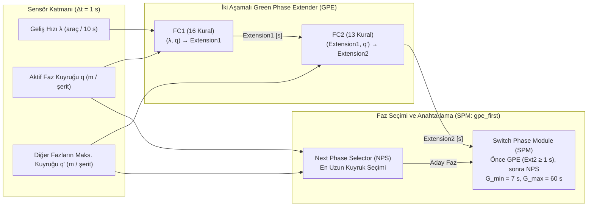

Makaledeki Şekil 4–7 esas alınarak tanımlanan dilsel değişkenler ve `configs/default.yaml` parametreleri (`shoulder_edges: true`, `and_operator: lukasiewicz`, `mf_sigma_scale: 1.0`, metin-şekil tutarsızlıkları için bkz. [`docs/assumptions.md`](docs/assumptions.md)):

| Değişken | Rol | Evren | Küme Tipi | Dilsel Terimler ve Parametreler |
| :--- | :--- | :---: | :---: | :--- |
| **Arrival Rate ($\lambda$)** | $\text{FC}_1$ Giriş 1 | $[0, 12]$ araç/10 s | Gauss ($\sigma = 1.0$) | `Z`: $c=0$, `Lo`: $c=3$, `M`: $c=6$, `H`: $c=9$ |
| **Queue Length ($q$)** | $\text{FC}_1$ Giriş 2 | $[0, 60]$ m/şerit | Gauss ($\sigma = 5.0$) | `Sh`: $c=0$, `M`: $c=15$, `L`: $c=30$, `VL`: $c=45$ |
| **Extension1 ($e_1$)** | $\text{FC}_1$ Çıkış / $\text{FC}_2$ Giriş 1 | $[0, 25]$ s | Üçgen $(a,b,c)$ | `Z`: $(0,0,7.5)$, `Sh`: $(0,7.5,12.5)$, `M`: $(7.5,12.5,17.5)$, `L`: $(12.5,17.5,22.5)$ |
| **Competing Queue ($q'$)** | $\text{FC}_2$ Giriş 2 | $[0, 60]$ m/şerit | Gauss ($\sigma = 5.0$) | `Sh`: $c=0$, `M`: $c=15$, `L`: $c=30$, `VL`: $c=45$ |
| **Extension2 ($e_2$)** | $\text{FC}_2$ Çıkış | $[0, 25]$ s | Üçgen / Tekil Tepe | Üçgen (Mamdani / CRI / OSFI-DJ) veya tepeler $\{0, 7.5, 12.5, 17.5\}$ |

- **Kural Tabanları:** 16 kurallı $\text{FC}_1$ ve 13 kurallı $\text{FC}_2$ tabloları ile makaledeki 6 örnek kural doğrulaması [`docs/rule_bases.md`](docs/rule_bases.md) dosyasındadır.

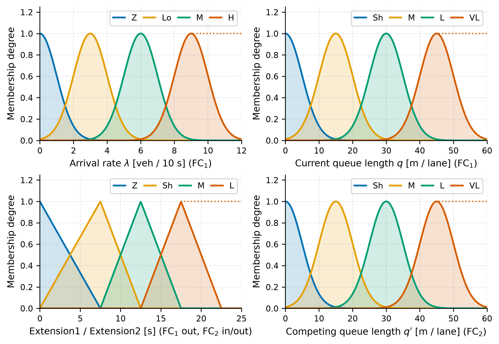

---

## Dataset

Referans makalede harici bir veri seti dosyası paylaşılmamıştır; dört fazlı izole kavşak trafiği Poisson gelişli ve üstel servisli $M/M/1$ kuyruk süreci olarak modellenmektedir ([`data/README.md`](data/README.md) ve [`src/osfi_tsc/sim/demand.py`](src/osfi_tsc/sim/demand.py)).

- **Kavşak Parametreleri:** Kesikli zaman ($\Delta t = 1\text{ s}$), 4 yaklaşım (`E, S, W, N`), kol başına 2 şerit, şerit başı $\mu = 0.5\text{ araç/s}$ (toplam $1.0\text{ araç/s}$ doygunluk akımı), $2\text{ s}$ başlangıç kayıp süresi, $5\text{ s}$ faz arası kayıp ($3\text{ s}$ sarı $+ 2\text{ s}$ tümü-kırmızı), araç uzunluğu $7.0\text{ m}$ ($3.5\text{ m/şerit}$), $600\text{ s}$ ısınma $+ 3600\text{ s}$ ölçüm penceresi.
- **Yön Dağılımı (Makale Tablo 1 Mamdani Çıkışlarından):** $\text{E}=328/1064 \approx 0.3083$, $\text{S}=398/1064 \approx 0.3741$, $\text{W}=165/1064 \approx 0.1551$, $\text{N}=173/1064 \approx 0.1626$ (toplam $1064\text{ araç/saat}$).
- **Kalibre Edilmiş YAML Senaryoları (`configs/scenarios/*.yaml`):** $[0, 60]\text{ m/şerit}$ kuyruk evrenini ve Tablo 1 hacmini yansıtacak şekilde tanımlanmıştır:

| Senaryo | YAML Dosyası | Profil | Toplam Talep $Q_{\text{tot}}(t)$ | Webster Akım Oranı $Y$ | Amaç |
| :--- | :--- | :---: | :--- | :---: | :--- |
| **`moderate`** | `configs/scenarios/moderate.yaml` | Sabit | $1100\text{ araç/saat}$ | $0.3056$ | Makale Tablo 1 hacmine ($\approx 1064$) doğrudan eşleşme |
| **`heavy`** | `configs/scenarios/heavy.yaml` | Sabit | $1500\text{ araç/saat}$ | $0.4167$ | $[0, 60]\text{ m}$ evreninin iç bölgesini (`Sh, M, L`) çalıştırma |
| **`peak`** | `configs/scenarios/peak.yaml` | Yamuk | $1100 \to 1800 \to 1100\text{ araç/saat}$ (ort. $1625$) | $0.4514$ | Zirve saat geçici yüklenme senaryosu |
| **`stress`** | `configs/scenarios/stress.yaml` | Sabit | $1800\text{ araç/saat}$ | $0.5000$ | Sıfırıncı dereceden Sugeno/OSFI-literal çöküşünü gösterme |

- **Ortak Rastgele Sayılar (CRN) ve Sensör Gürültüsü Akımları:** Her tohum $s \in \{202501, \dots, 202530\}$ için izole `PCG64` akımları kullanılır (`s` gelişler, `s+1_000_003` servis, `s+2_000_003` $\hat{q}=\max(0, q+\mathcal{N}(0,\sigma_q^2))$ kuyruk gürültüsü $\sigma_q \in \{0,5,10,15\}\text{ m}$, `s+3_000_003` $\text{Binomial}(1-p_{\text{miss}})$ kaçırılan araç + $p_{\text{miss}}>0$ iken $\text{Poisson}(\varepsilon=0.02\text{ araç/s})$ yanlış sayım).

---

## Installation

```bash
git clone https://github.com/oiscanli/osfi-traffic-signal-control.git
cd osfi-traffic-signal-control
python3 -m venv .venv
source .venv/bin/activate
pip install --upgrade pip
pip install -r requirements.txt
pip install -e .
```

---

## Requirements

- **Python:** 3.10+ (test edilen ortam: Python 3.13)
- **Bağımlılıklar ([`requirements.txt`](requirements.txt)):**
  - `numpy==2.5.4`
  - `scipy==1.18.1`
  - `pandas==3.1.1`
  - `matplotlib==3.11.2`
  - `PyYAML==6.0.3`
  - `pytest==9.2.0`
  - `tqdm==4.70.1`
- **Önemli Kısıt:** `scikit-fuzzy` veya harici bir bulanık mantık paketi **kullanılmamıştır**; tüm üyelik fonksiyonları, t-normlar, implikatörler, `OSFI-DJ`, `CRI`, `Mamdani`, `Sugeno` ve `OSFI-literal` operatörleri sıfırdan gerçeklenmiştir.

---

## How to Run

Temiz bir kurulumdan paket kurulumunu, birim testlerini (`36` test), yeniden üretim deneylerini, özgün katkı deneylerini (50 LUT + 7.590 simülasyon koşusu) ve figür üretimini çalıştırmak için:

```bash
source .venv/bin/activate
pip install -e .
pytest -q
python scripts/run_reproduction.py
python scripts/run_contribution.py
python scripts/make_figures.py
```

Alternatif olarak Yönerge §9 deney yapılandırmalarını doğrudan çalıştırmak için:

```bash
python scripts/run_reproduction.py --config experiments/baseline/config.yaml --output results
python scripts/run_contribution.py --config experiments/proposed/config.yaml --output results
```

### Depo Yapısı (Guideline §9)

```text
osfi-tsc/
├── README.md  LICENSE  requirements.txt  .gitignore  pyproject.toml
├── configs/
│   ├── default.yaml
│   └── scenarios/{moderate,heavy,peak,stress}.yaml
├── data/
│   └── README.md
├── docs/
│   ├── assumptions.md  experiment_log.md  osfi_theory.md  paper_inconsistencies.md  rule_bases.md
├── experiments/
│   ├── baseline/{config.yaml, README.md}
│   └── proposed/{config.yaml, README.md}
├── presentation/
├── references/
│   └── README.md
├── report/
├── results/
│   ├── cache/            # 50 adet önbelleğe alınmış 2B LUT (.npz)
│   ├── figures/          # Tüm akademik figürler (.pdf + .png)
│   ├── raw/              # Tohum bazlı ham simülasyon CSV'leri
│   └── tables/           # Özet istatistikler, Wilcoxon ve LUT tabloları (.csv + .md)
├── scripts/
│   ├── run_reproduction.py  run_contribution.py  make_figures.py
│   └── demo_inference.py    demo_gui.py          demo_sim.py
├── src/osfi_tsc/
│   ├── fuzzy/{membership.py, operators.py, rules.py}
│   ├── inference/{mamdani.py, sugeno.py, osfi_literal.py, cri.py, osfi_dj.py}
│   ├── control/{fuzzy_controller.py, webster.py, actuated.py}
│   ├── sim/{demand.py, intersection.py}
│   └── metrics.py  experiment.py  contribution.py  plotting.py
└── tests/
    ├── test_fuzzy_primitives.py  test_inference.py  test_osfi_dj.py
    └── test_sim_and_controllers.py  test_demos.py
```

---

## Canlı Demo

Sözlü savunma ve canlı gösterim için üç etkileşimli demo betiği sunulmaktadır:
- **`scripts/demo_inference.py`:** Girilen $(\lambda, q_{\text{cur}}, q_{\text{others}}, \sigma_q)$ için bulanıklaştırma derecelerini, `min` vs. Łukasiewicz t-normu altında en yüksek ateşlemeli 5 kuralı, ölü bölge fallback durumunu ve 7 motorun (`Mamdani`, `Sugeno`, `OSFI-literal`, `OSFI-DJ-S`, `CRI-S`, `OSFI-DJ-NS`, `CRI-NS`) `Extension1/2` ve `SPM` (`gpe_first`) kararlarını anlık yazdırır.
- **`scripts/demo_gui.py`:** $\lambda$, $q_{\text{cur}}$, $q'_{\text{others}}$, $\sigma_q$ sürgüleri ve çıkarım motoru radyo düğmeleriyle 4 panelli canlı Matplotlib arayüzü açar (giriş MFs, ateşlenen kurallar, $B^*(y)$ çıkış eğrileri + yukarı-çekilmiş merkezler, aşamalı karar özeti).
- **`scripts/demo_sim.py`:** Tek bir ortak rastgele sayı (CRN) tohumunda canlı kavşak simülasyonunu çalıştırır, özet metrik tablosunu basar, zaman serisi çizer ve `--animate` bayrağıyla hızlı kuyruk çubuğu animasyonu oynatır.

### Önerilen 3 Canlı Demo Durumu

1. **Normal çalışma noktası (*Normal case* — aktif kurallar, fallback yok):**
   ```bash
   python scripts/demo_inference.py --lam 3.2 --q 18 --qo 30 --sigma-q 10
   python scripts/demo_gui.py --lam 3.2 --q 18 --qo 30 --sigma-q 10 --engine OSFI-DJ-NS
   ```
   - `Ext1 / Ext2 / SPM` çıktıları: `Mamdani` `6.780 / 2.615 s` (`extend 3 s`), `Sugeno` `7.533 / 0.208 s` (`switch to S`), `OSFI-literal` `7.500 / 0.082 s` (`switch to S`), `OSFI-DJ-S == CRI-S` `6.644 / 2.468 s` (`extend 2 s`), `OSFI-DJ-NS` `6.668 / 2.535 s` (`extend 3 s`), `CRI-NS` `6.497 / 2.753 s` (`extend 3 s`). Sıfır fallback.

2. **Łukasiewicz-AND ölü bölge noktası (*Dead-zone case* — kesişim çöküşü ve en-yakın-kural fallback):**
   ```bash
   python scripts/demo_inference.py --lam 4.5 --q 22.5 --qo 22.5 --sigma-q 10
   ```
   - $\lambda=4.5$ (`Lo=0.3247, M=0.3247`) ve $q=22.5$ (`M=0.3247, L=0.3247`) noktasında tüm `FC1` kuralları için $a+b-1 \le 0$ olur ($\max_i \alpha_i = 0$). `Mamdani` ve `Sugeno` `min` ile normal çalışırken (`8.944 / 8.163 s` ve `8.750 / 6.469 s`), Łukasiewicz kullanan `OSFI-literal` (`7.500 / 3.750 s`), `OSFI-DJ-S` & `CRI-S` (`7.500 / 5.150 s`), `OSFI-DJ-NS` (`7.500 / 3.751 s`) ve `CRI-NS` (`7.500 / 3.757 s`) kontrollü biçimde **`YES (FC1/-)`** en-yakın-kural geri-düşüşünü (`Ext1 = 7.500 s`) tetikler.

3. **Gürültülü sensör simülasyonu (*Noisy sensor simulation & high-noise inference*):**
   ```bash
   python scripts/demo_sim.py --scenario heavy --controllers Mamdani,OSFI-DJ-S,OSFI-DJ-NS,Webster --seed 1 --sigma-q 10 --p-miss 0.1
   python scripts/demo_sim.py --scenario heavy --controllers Mamdani,OSFI-DJ-S,OSFI-DJ-NS,Webster --seed 1 --sigma-q 10 --p-miss 0.1 --animate
   python scripts/demo_inference.py --lam 6.0 --q 35 --qo 40 --sigma-q 15
   ```
   - `heavy` ($\sigma_q=10\text{ m}, p_{\text{miss}}=0.1$, `seed=1`) tek-tohum canlı simülasyonunda ortalama gecikmeler `Mamdani: 36.70 s`, `OSFI-DJ-S: 32.01 s`, `OSFI-DJ-NS: 33.29 s` (en yüksek çıkış `1539 araç` ve `2.56%` fallback) ve `Webster: 37.56 s` olarak gözlenir; `--lam 6.0 --q 35 --qo 40 --sigma-q 15` noktasında ise `Sugeno`/`OSFI-literal` `1.365 s` uzatma üretirken `OSFI-DJ-NS` `2.785 s` (`extend 3 s`) kararı verir.

---

## Reproduction Experiments

### 1. Kontrol Yüzeyleri ($\text{FC}_1$ ve $\text{FC}_2$)

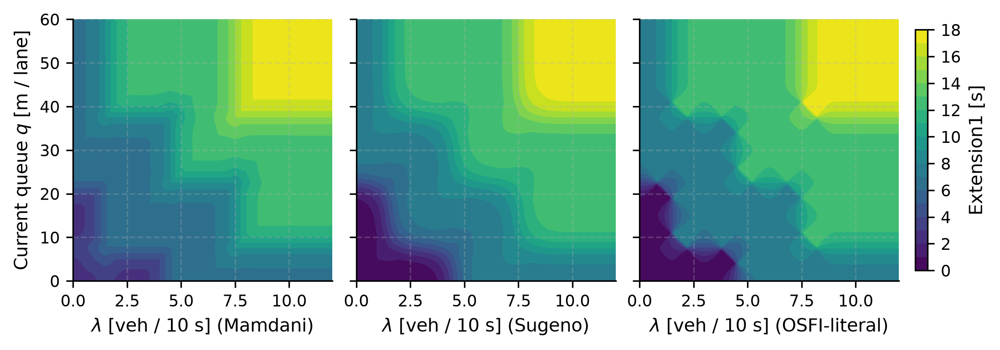


### 2. Makale Tablo 1 / Tablo 2 Biçiminde Karşılaştırma (`n = 30` Tohum)

> **Fiziksel Ölçek ve İşaret Notu:** Referans makale Tablo 1–2'de 4 fazlı bir kavşak için fiziksel olarak imkânsız $1.011\text{--}1.210\text{ s/araç}$ gecikmeler ve çıkış sayılarında ters işaretli yüzdeler raporlamaktadır (ayrıntılı denetim: [`docs/paper_inconsistencies.md`](docs/paper_inconsistencies.md) ve [`results/tables/paper_vs_ours.md`](results/tables/paper_vs_ours.md)). Aşağıda doğru işaret kuralıyla (düşük gecikme ve yüksek çıkış pozitif) Stage 3 kalibreli sonuçlarımız özetlenmiştir:

#### Orta Yoğunluklu Trafik (`moderate`, $1100\text{ araç/saat}$, [`results/tables/paper_style_table_moderate.md`](results/tables/paper_style_table_moderate.md))

| Indicator | Phase | Mamdani | Sugeno | OSFI-literal | % Imp. vs Mamdani | % Imp. vs Sugeno | Paper Claimed Direction Reproduced? |
| :--- | :---: | ---: | ---: | ---: | ---: | ---: | :--- |
| Average Delay (s) | E | 17.15 | 17.26 | 20.15 | -17.52% | -16.73% | No |
| Average Delay (s) | S | 16.26 | 17.04 | 19.82 | -21.88% | -16.32% | No |
| Average Delay (s) | W | 30.35 | 29.87 | 33.81 | -11.40% | -13.17% | No |
| Average Delay (s) | N | 31.55 | 32.43 | 36.72 | -16.38% | -13.23% | No |
| Average Exit (veh) | E | 342.8 | 343.4 | 343.1 | +0.11% | -0.09% | Partial (vs Mamdani only) |
| Average Exit (veh) | S | 415.9 | 416.2 | 415.5 | -0.08% | -0.15% | No |
| Average Exit (veh) | W | 173.8 | 173.8 | 173.4 | -0.27% | -0.27% | No |
| Average Exit (veh) | N | 176.0 | 175.7 | 176.0 | -0.04% | +0.15% | Partial (vs Sugeno only) |

#### Yoğun Trafik (`heavy`, $1500\text{ araç/saat}$, [`results/tables/paper_style_table_heavy.md`](results/tables/paper_style_table_heavy.md))

| Indicator | Phase | Mamdani | Sugeno | OSFI-literal | % Imp. vs Mamdani | % Imp. vs Sugeno | Paper Claimed Direction Reproduced? |
| :--- | :---: | ---: | ---: | ---: | ---: | ---: | :--- |
| Average Delay (s) | E | 21.23 | 37.05 | 53.23 | -150.73% | -43.68% | No |
| Average Delay (s) | S | 19.25 | 32.93 | 47.82 | -148.42% | -45.22% | No |
| Average Delay (s) | W | 37.50 | 66.35 | 92.92 | -147.83% | -40.04% | No |
| Average Delay (s) | N | 37.40 | 65.47 | 94.35 | -152.27% | -44.11% | No |
| Average Exit (veh) | E | 465.3 | 462.1 | 459.7 | -1.19% | -0.51% | No |
| Average Exit (veh) | S | 560.5 | 556.8 | 554.5 | -1.08% | -0.41% | No |
| Average Exit (veh) | W | 232.0 | 230.7 | 228.7 | -1.44% | -0.87% | No |
| Average Exit (veh) | N | 244.8 | 241.9 | 241.1 | -1.54% | -0.33% | No |

### 3. Senaryolar Genelinde Gecikme Dağılımı, Çöküş Analizi ve Sağlamlık Kapıları

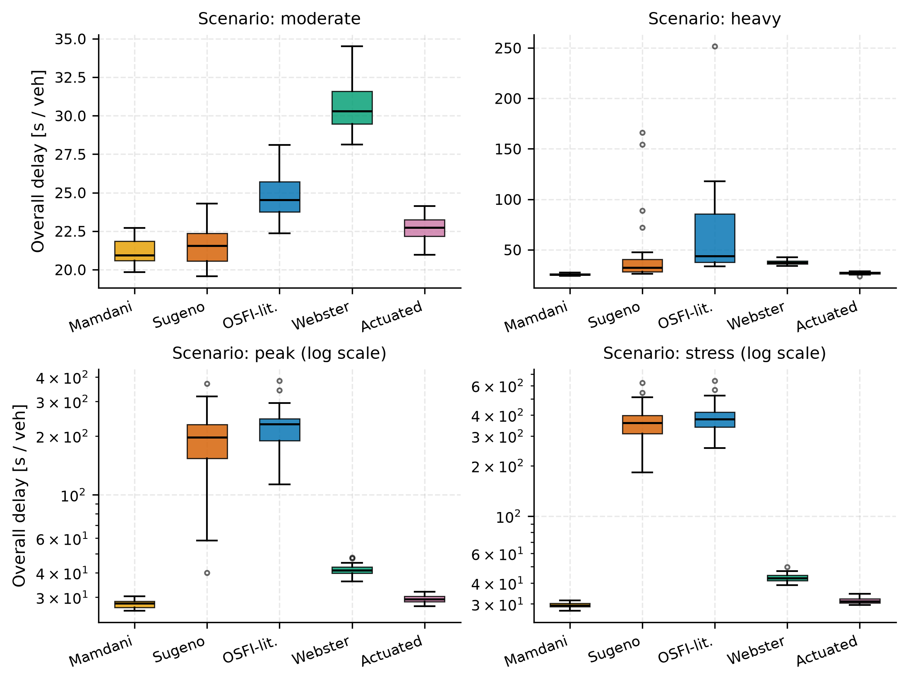

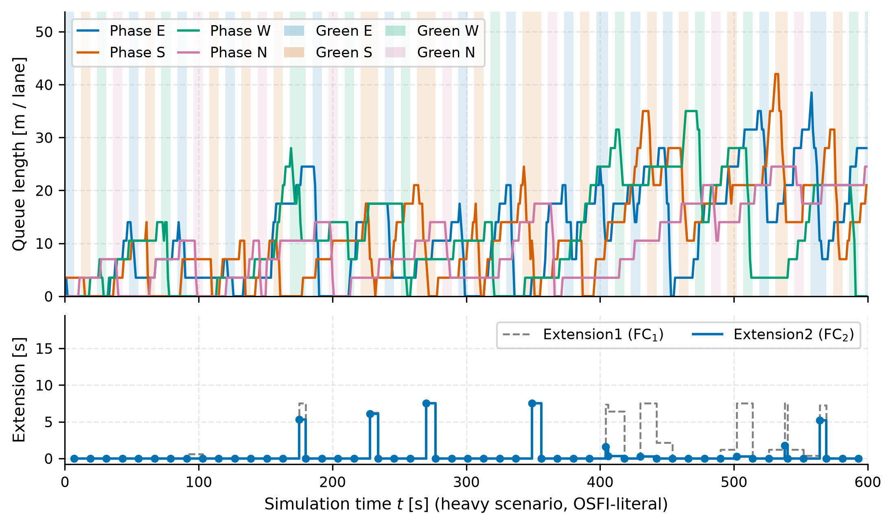

- **Kalibrasyon Sağlamlık Kapıları (`docs/experiment_log.md`):** `moderate`, `heavy` ve `peak` senaryolarında çıkış oranı $\ge 99.81\%$ olarak gerçekleşmiş (`PASS`), `Mamdani` diğer-kuyruk girdisi $q_{\text{other}}$ havuzlanmış (`moderate+heavy`) dağılımda `Sh=20.3% / M=65.9% / L=13.1% / VL=0.7%` ile $\ge 3$ dilsel kümeyi $\ge 5\%$ kapsayarak evreni etkin biçimde kullanmıştır ([`results/tables/input_coverage_summary.md`](results/tables/input_coverage_summary.md)).
- **İstatistiksel Testler ([`results/tables/wilcoxon_tests.md`](results/tables/wilcoxon_tests.md)):** `OSFI-literal` tüm senaryolarda hem `Mamdani`'den hem de `Sugeno`'dan anlamlı biçimde daha yüksek gecikme üretmektedir (`moderate`: $24.75$ vs $21.13/21.51\text{ s}$; `heavy`: $63.79$ vs $25.58/44.52\text{ s}$; `peak`: $219.23$ vs $27.72/192.97\text{ s}$; `stress`: $390.92$ vs $29.48/366.76\text{ s}$; tüm çiftli `avg_delay_s` testlerinde Holm $p \le 0.005585$).
- **Yapısal Neden — `Sugeno` / `OSFI-literal` Çöküşü:** Sıfırıncı dereceden modellerde `Z` çıkışının tekil tepe değeri $0.0\text{ s} < 1.0\text{ s}$ olduğu için `peak` ve `stress` yüklerinde kontrolcü $\text{Extension2} < 1\text{ s}$ eşiğine çarparak neredeyse her $G_{\min}=7\text{ s}$ sonunda faz değiştirir (`287–299` anahtarlama/saat), oysa ağırlık merkezli `Mamdani` ($\text{Z}$ üçgeni ağırlık merkezi $\approx 2.50\text{ s}$) yeşil süreyi uzatarak $185\text{--}200$ anahtarlama/saat düzeyinde kalır ve doygunluğu önler.

---

## Proposed Extension

### 1. Kuramsal Katkı: Deng & Jiang (2014) OSFI ve Tekil Giriş Eşdeğerliği (Proposition 1)

Deng & Jiang (2014) doğruluk tablosu benzerlik optimizasyonunun ayrışan $d_1$ amaç fonksiyonu her kural $i$ ve çıkış noktası $y \in [0, 25]\text{ s}$ için $b \in [0, 1]$ ($201$ nokta + tam V-kink analitik kurtarma) üzerinde çözülmüştür ([`docs/osfi_theory.md`](docs/osfi_theory.md)):

$$B^*_i(y) = \arg\min_{b \in [0, 1]} \sum_{x \in X} \bigl| I(A_i(x), B_i(y)) - I(A^*(x), b) \bigr|$$

> **Önerme 1 (Singleton Equivalence):** $A^*$ bir $x_0$ hücresinde tekil küme ise ($A^*(x_0)=1$, $x \neq x_0$ için $A^*(x)=0$):
> 1. $I(0, b) = 1$ ve $I(1, b) = b$ koşullarını sağlayan gerçek implikatörlerde (**Łukasiewicz**, **Goguen**, **Kleene-Dienes**) tüm $x \neq x_0$ terimleri sabit kalır ve çözüm $B^*_{\text{OSFI}}(y) = I(A_i(x_0), B_i(y)) = B^*_{\text{CRI}}(y)$ olarak **CRI ile birebir çakışır** (ızgara noktalarında mutlak fark $< 10^{-15}$).
> 2. **Mamdani-min** için ($I_M(0,b)=0$) çözüm $[\min(A_i(x_0), B_i(y)), 1]$ platosunun sol ucu (`smallest`) olan $\min(A_i(x_0), B_i(y))$ Mamdani kırpma sonucudur.
> 3. **Sonuç:** Benzerlik optimizasyonu CRI'dan **yalnızca tekil-olmayan (*non-singleton*) girişlerde ($\sigma > 0$)** ayrışır; CRI tek bir $\sup_x$ hücresine bakarken, OSFI-DJ aktif destek kümesi üzerinde ağırlıklı $L_1$ medyan optimizasyonu gerçekleştirir.

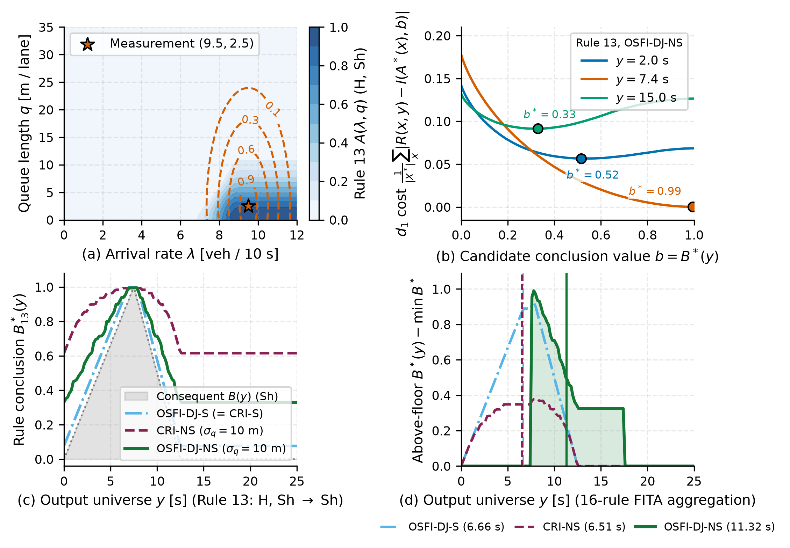

### 2. Tekil-Olmayan Motorlar, Ölü Bölge Haritası ve 2B LUT Hızlandırması

- **Hızlı 2B LUT Önbelleği (`50` `.npz` Tablosu, [`results/tables/contribution_lut_stats.md`](results/tables/contribution_lut_stats.md)):** Doğrudan çıkarım `OSFI-DJ-NS` için $7.760\text{ ms/çağrı}$ (`OSFI-DJ-S` $1.303\text{ ms/çağrı}$) tutarken, 2B arama tabloları çalışma zamanını **`20.62 µs/çağrı`** ($376\times$ hızlanma; $500$ rastgele ızgara-dışı noktada medyan hata $\le 0.0127\text{ s}$) düzeyine indirir.
- **Ölü Bölge Haritası ve Birleşik Geri-Düşüş:** Şekil `dead_zone_map.png`, Łukasiewicz AND + $\sigma \times 1.0$ altında giriş düzleminin **%5.0**'ini kaplayan 9 elmas ölü bölgeyi ve bunların `and_operator = min` veya `mf_sigma_scale = 1.5` ile **%0.0**'a indirgendiğini gösterir.


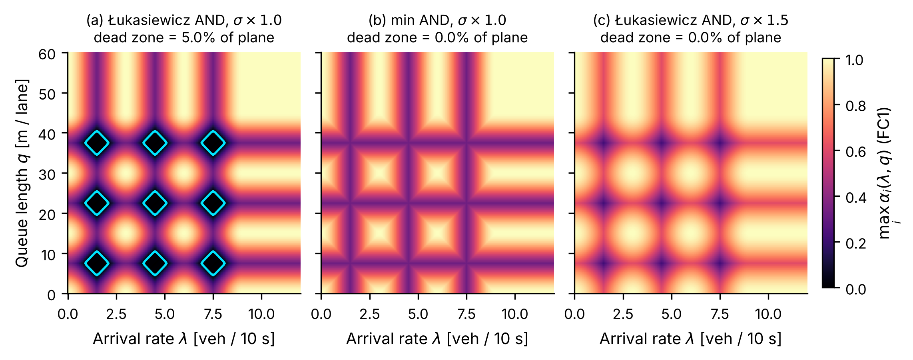

---

## Experimental Results

### 1. Deney A — Gürültüsüz Ortamda Genişletilmiş Karşılaştırma (`n = 30` Tohum, [`results/tables/contribution_exp_a_summary.md`](results/tables/contribution_exp_a_summary.md))

| Scenario | Controller | Avg Delay (s/veh) $\pm$ 95% CI | Throughput (veh) $\pm$ 95% CI | Discharge (%) | Mean Queue (m/lane) | Switches | Dead-Zone Fallback Rate (Total / FC1 / FC2) |
| :--- | :--- | ---: | ---: | ---: | ---: | ---: | :---: |
| `moderate` | `Mamdani` | 21.13 $\pm$ 0.30 | 1108.5 $\pm$ 13.7 | 99.96% | 5.73 | 245.1 | 0.00% (0.00% / 0.00%) |
| `moderate` | `Sugeno` | 21.51 $\pm$ 0.46 | 1109.1 $\pm$ 13.4 | 100.02% | 5.83 | 278.8 | 0.00% (0.00% / 0.00%) |
| `moderate` | `OSFI-literal` | 24.75 $\pm$ 0.47 | 1108.0 $\pm$ 13.5 | 99.91% | 6.70 | 288.1 | 2.96% (5.91% / 0.00%) |
| `moderate` | **`OSFI-DJ-S` (`== CRI-S`)** | **19.82 $\pm$ 0.29** | 1108.3 $\pm$ 13.7 | 99.94% | **5.37** | 262.0 | 2.41% (4.81% / 0.00%) |
| `moderate` | `Webster` / `Actuated` | 30.57 / 22.63 | 1109.3 / 1108.3 | 100.03% / 99.94% | 8.28 / 6.11 | 214.0 / 251.8 | 0.00% |
| `heavy` | `Mamdani` | 25.58 $\pm$ 0.29 | 1502.6 $\pm$ 15.9 | 100.00% | 9.40 | 210.6 | 0.00% (0.00% / 0.00%) |
| `heavy` | `Sugeno` / `OSFI-literal` | 44.52 / 63.79 | 1491.4 / 1483.9 | 99.27% / 98.78% | 16.55 / 23.56 | 268.1 / 280.7 | 0.00% / 2.43% |
| `heavy` | **`OSFI-DJ-S` (`== CRI-S`)** | **24.07 $\pm$ 0.35** | 1502.3 $\pm$ 16.5 | 99.97% | **8.84** | 227.0 | 3.63% (7.27% / 0.00%) |
| `heavy` | `Webster` / `Actuated` | 37.69 / 26.91 | 1499.8 / 1503.5 | 99.81% / 100.06% | 13.84 / 9.87 | 178.0 / 217.9 | 0.00% |
| `peak` | `Mamdani` | 27.72 $\pm$ 0.45 | 1627.6 $\pm$ 15.6 | 100.01% | 10.99 | 199.7 | 0.00% (0.00% / 0.00%) |
| `peak` | `Sugeno` / `OSFI-literal` | 192.97 / 219.23 | 1487.1 / 1471.9 | 91.44% / 90.50% | 79.02 / 89.46 | 287.0 / 292.7 | 0.00% / 1.08% |
| `peak` | **`OSFI-DJ-S` (`== CRI-S`)** | **26.26 $\pm$ 0.42** | 1627.4 $\pm$ 15.6 | 100.00% | **10.41** | 214.9 | 3.70% (7.39% / 0.00%) |
| `peak` | `Webster` / `Actuated` | 41.18 / 29.30 | 1626.0 / 1628.3 | 99.91% / 100.05% | 16.34 / 11.61 | 167.0 / 205.0 | 0.00% |
| `stress` | `Mamdani` | 29.48 $\pm$ 0.36 | 1800.8 $\pm$ 15.3 | 100.00% | 12.97 | 185.0 | 0.00% (0.00% / 0.00%) |
| `stress` | `Sugeno` / `OSFI-literal` | 366.76 / 390.92 | 1506.3 / 1500.6 | 83.70% / 83.39% | 163.26 / 173.50 | 298.1 / 299.2 | 0.00% / 0.05% |
| `stress` | **`OSFI-DJ-S` (`== CRI-S`)** | **27.94 $\pm$ 0.39** | 1802.1 $\pm$ 14.8 | 100.08% | **12.30** | 198.0 | 3.85% (7.70% / 0.00%) |
| `stress` | `Webster` / `Actuated` | 43.06 / 31.25 | 1802.4 / 1801.2 | 100.10% / 100.03% | 18.94 / 13.72 | 153.0 / 188.9 | 0.00% |

- `OSFI-DJ-S` ve `CRI-S` Önerme 1 uyarınca 4 senaryonun tamamında noktası noktasına özdeş (`19.82`, `24.07`, `26.26`, `27.94 s/araç`) sonuç vermekte; hem `Mamdani`'yi ($\%5.2\text{--}6.2$ daha düşük gecikme) hem `Actuated` ve `Webster`'ı geçmekte hem de `stress` senaryosunda çöken `OSFI-literal`'e ($390.92\text{ s}$) kıyasla $-92.9\%$ iyileşme sağlamaktadır.

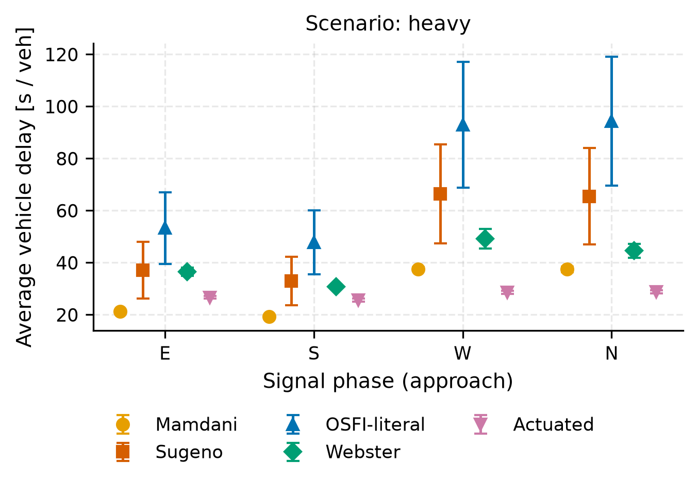

### 2. Baseline vs. Önerilen Yöntem Karşılaştırma Tablosu (Guideline §6.2, [`results/tables/contribution_comparison.md`](results/tables/contribution_comparison.md))

| Performans Ölçütü | Baseline (`OSFI-DJ-S`) | Önerilen (`OSFI-DJ-NS`) | Değişim |
| :--- | ---: | ---: | ---: |
| Average Delay — Heavy ($\sigma_q=0\text{ m}, p_{\text{miss}}=0.0$) | 24.07 ± 0.35 s | **23.67 ± 0.34 s** | -0.40 s (-1.65%) |
| Average Delay — Heavy ($\sigma_q=10\text{ m}, p_{\text{miss}}=0.0$) | 33.57 ± 0.52 s | **33.44 ± 0.59 s** | -0.13 s (-0.40%) |
| Average Delay — Heavy ($\sigma_q=10\text{ m}, p_{\text{miss}}=0.1$) | 33.82 ± 0.47 s | **32.80 ± 0.48 s** | **-1.02 s (-3.02%)** |
| Average Delay — Heavy ($\sigma_q=15\text{ m}, p_{\text{miss}}=0.1$) | 36.59 ± 0.56 s | **36.18 ± 0.48 s** | -0.41 s (-1.12%) |
| Average Delay — Peak ($\sigma_q=0\text{ m}, p_{\text{miss}}=0.0$) | 26.26 ± 0.42 s | **25.98 ± 0.42 s** | -0.28 s (-1.05%) |
| Average Delay — Peak ($\sigma_q=10\text{ m}, p_{\text{miss}}=0.0$) | 35.77 ± 0.53 s | **35.20 ± 0.65 s** | -0.57 s (-1.59%) |
| Average Delay — Peak ($\sigma_q=10\text{ m}, p_{\text{miss}}=0.1$) | 36.01 ± 0.51 s | **35.34 ± 0.66 s** | -0.67 s (-1.87%) |
| Execution Time per Inference (Direct, 10k calls) | 1.303 ms | 7.760 ms | +6.457 ms (+495.6%) |
| Execution Time per Inference (2D LUT Lookup, 10k calls) | 20.76 µs | 20.62 µs | -0.15 µs (-0.7%) |
| Offline LUT Precomputation Build Time (FC1 + FC2) | 0.92 s | 3.92 s | +2.99 s (+323.7%) |

### 3. Deney B — Sensör Gürültüsü Izgarası ($\sigma_q \times p_{\text{miss}}$, `6,480` Koşu)

Tam tablolar ve 96 eşleştirilmiş Wilcoxon testi için bkz. [`results/tables/contribution_exp_b_summary.md`](results/tables/contribution_exp_b_summary.md) ve [`results/tables/contribution_wilcoxon.md`](results/tables/contribution_wilcoxon.md):

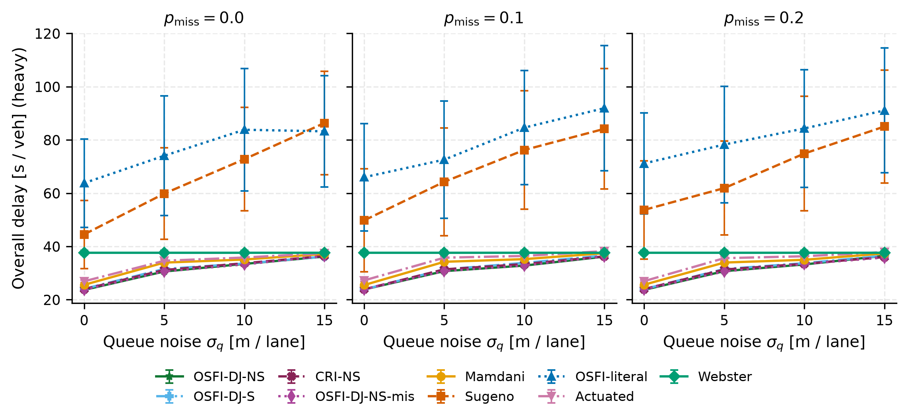

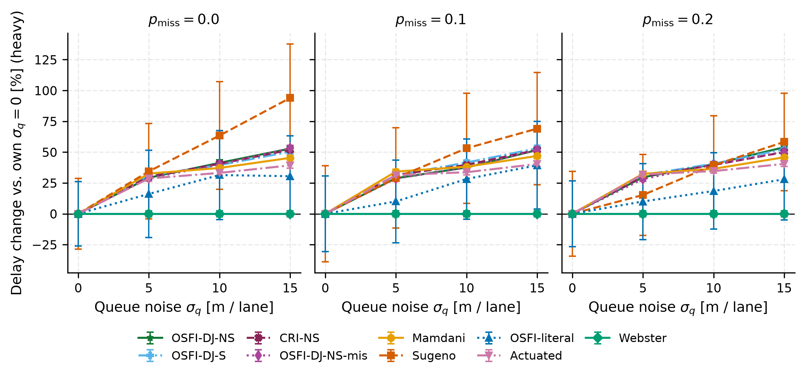

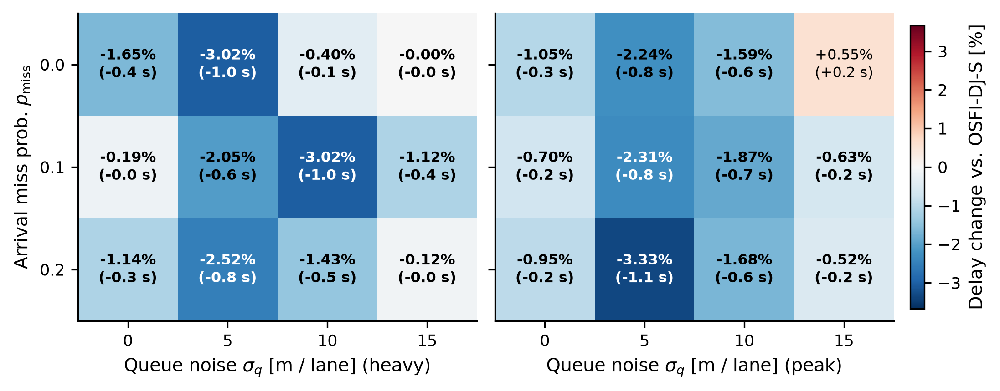

- **`Mamdani` ve `Sugeno`'ya Karşı Tutarlı Üstünlük:** Hem `heavy` hem `peak` senaryolarındaki **12/12** gürültü hücresinin tamamında `OSFI-DJ-NS`, `Mamdani` ve `Sugeno`'dan istatistiksel olarak anlamlı biçimde daha düşük gecikme elde etmektedir (Holm $p \le 0.03614$; `Mamdani`'ye göre medyan kazanç `-2.13%` ile `-10.51%`, `Sugeno`'ya göre `-24.17%` ile `-87.49%`).
- **`OSFI-DJ-S` ve `CRI-NS`'ye Karşı Kazanımlar:** `OSFI-DJ-NS`, `OSFI-DJ-S`'yi `heavy` senaryoda **6/12** hücrede ve `peak` senaryoda **3/12** hücrede istatistiksel olarak anlamlı biçimde geride bırakmaktadır (örneğin `heavy` $\sigma_q=10\text{ m}, p_{\text{miss}}=0.1$ hücresinde `32.80` vs `33.82 s/araç`, $-3.02\%$, $p_{\text{Holm}} = 4.63 \times 10^{-4}$; `CRI-NS` `33.37 s/araç`, $p_{\text{Holm}} = 0.00711$). Aşırı kuyruk gürültüsünde ($\sigma_q = 15\text{ m}$) ise ham kuyruk anahtarlama koşulu baskınlaşarak tekil ve tekil-olmayan motorlar arasındaki farkı $\%0\text{--}1.1$ düzeyine yakınsamaktadır ($p_{\text{Holm}} > 0.41$).

### 4. Deney C — 9 Varyantlı Ablasyon Çalışması (`heavy`, $\sigma_q = 10\text{ m}$, $p_{\text{miss}} = 0$, `n = 30` Tohum, [`results/tables/contribution_exp_c_summary.md`](results/tables/contribution_exp_c_summary.md))


| Faktör | Varyant | Ortalama Gecikme (s/araç) $\pm$ 95% CI | Çıkış (araç) | Anahtarlama | Ölü Bölge Fallback |
| :--- | :--- | ---: | ---: | ---: | ---: |
| **Baseline** | `lukasiewicz` + `smallest` + `centroid_above_floor` + `shoulder` + `gpe_first` | 33.44 $\pm$ 0.59 | 1500.6 $\pm$ 16.4 | 193.7 | 2.56% |
| **Implicator** | `goguen` implikatörü | **32.04 $\pm$ 0.35** | 1502.4 $\pm$ 16.6 | 206.1 | 1.04% |
| **Implicator** | `kleene_dienes` implikatörü | 34.31 $\pm$ 0.59 | 1501.8 $\pm$ 16.4 | 216.8 | 27.88% |
| **Tie-Break** | `midpoint` eşitlik bozma | 33.34 $\pm$ 0.46 | 1500.7 $\pm$ 16.4 | 194.0 | 2.65% |
| **Defuzzifier** | `centroid` (taban dahil standart ağırlık merkezi) | 49.60 $\pm$ 0.75 | 1502.0 $\pm$ 16.1 | 110.0 | 0.00% |
| **Boundary MFs** | `shoulder_edges = False` | 33.31 $\pm$ 0.50 | 1500.9 $\pm$ 16.5 | 194.5 | 2.65% |
| **Antecedent AND** | `and_operator = min` (ölü bölgeleri kaldırır) | 33.88 $\pm$ 0.47 | 1501.5 $\pm$ 16.3 | 188.8 | **0.00%** |
| **MF Width** | `mf_sigma_scale = 1.5` (genişletilmiş Gausslar) | 32.90 $\pm$ 0.48 | 1501.8 $\pm$ 16.0 | 193.9 | **0.00%** |
| **Phase Switching** | `spm_mode = preempt` (çırpınma ablasyonu) | 55.54 $\pm$ 9.97 | 1499.4 $\pm$ 17.7 | 276.0 | 2.90% |

**Ablasyon Yorumları:**
- `spm_mode = preempt` faz geçişlerini saatte `276.0`'a fırlatarak gecikmeyi `33.44 s`'den **`55.54 s`**'ye ($+66.1\%$) bozmakta; `gpe_first` düzeltmesinin gerekliliğini doğrudan doğrulamaktadır.
- Standart `centroid` durulaştırıcısı $(1-\alpha)$ tabanı nedeniyle uzatmaları $12.5\text{ s}$ evren ortasına çekip anahtarlamaları `110.0`'e düşürerek bekleyen kolları geciktirmekte (`49.60 s`), **`centroid_above_floor`** ise bunu **`33.44 s`**'ye indirmektedir.
- `kleene_dienes` yüksek taban/düz plato nedeniyle `%27.88` fallback tetiklerken `goguen` `%1.04` fallback ile **`32.04 s`** gecikmeye ulaşmaktadır; `and_operator = min` veya `mf_sigma_scale = 1.5` ise ölü bölge fallback oranını **`0.00%`**'a sıfırlamaktadır (`33.88 s` ve `32.90 s`).

---

## Limitations

- Simülatör dört kollu izole tek bir kavşağı kapsamakta olup koridor koordinasyonu (yeşil dalga), yaya fazları veya korumalı dönüş fazlarını modellememektedir.
- Referans makalede $\text{FC}_1$ için 16, $\text{FC}_2$ için 13 kuraldan yalnızca 3'er örnek kural açıkça yazıldığı için kalan 13+10 kural monoton indeks kurallarıyla tamamlanmıştır ([`docs/rule_bases.md`](docs/rule_bases.md)).
- Çok yüksek kuyruk sensörü gürültüsünde ($\sigma_q = 15\text{ m/şerit}$), `SPM`'deki ham kuyruk karşılaştırması GPE'nin tekil-olmayan yumuşatma kazancını baskılayarak `OSFI-DJ-NS` ile `OSFI-DJ-S` arasındaki farkı kapatmaktadır.
- `mf_sigma_scale = 1.0` altında Łukasiewicz t-normunun %5.0 elmas ölü bölgesi doğası gereği oluşmakta olup adil karşılaştırma için makale parametreleri korunmuş, çözüm yolu (`min` AND / $\sigma \times 1.5$) ablasyonlarla gösterilmiştir.

---

## References

1. M. Esmaeili, A. Anjomshoae, N. Shahsavari-Pour, P. Srisurin, and R. Banomyong, "An optimization similarity fuzzy inference method for traffic signal control at an isolated intersection," *Multimodal Transportation*, vol. 4, Art. no. 100234, 2025, doi: [10.1016/j.multra.2025.100234](https://doi.org/10.1016/j.multra.2025.100234).
2. G. Deng and Y. Jiang, "Fuzzy reasoning method by optimizing the similarity of truth-tables," *Information Sciences*, vol. 288, pp. 290–313, 2014, doi: [10.1016/j.ins.2014.08.006](https://doi.org/10.1016/j.ins.2014.08.006).
3. C. P. Pappis and E. H. Mamdani, "A fuzzy logic controller for a traffic junction," *IEEE Transactions on Systems, Man, and Cybernetics*, vol. 7, no. 10, pp. 707–717, 1977, doi: [10.1109/TSMC.1977.4309605](https://doi.org/10.1109/TSMC.1977.4309605).
4. L. A. Zadeh, "Fuzzy sets," *Information and Control*, vol. 8, no. 3, pp. 338–353, 1965, doi: [10.1016/S0019-9958(65)90241-X](https://doi.org/10.1016/S0019-9958(65)90241-X).
5. L. A. Zadeh, "Similarity relations and fuzzy orderings," *Information Sciences*, vol. 3, no. 2, pp. 177–200, 1971, doi: [10.1016/S0020-0255(71)80005-1](https://doi.org/10.1016/S0020-0255(71)80005-1).
6. R. E. Bellman and L. A. Zadeh, "Decision-making in a fuzzy environment," *Management Science*, vol. 17, no. 4, pp. B-141–B-164, 1970, doi: [10.1287/mnsc.17.4.B141](https://doi.org/10.1287/mnsc.17.4.B141).
7. D.-G. Wang, Y.-P. Meng, and H.-X. Li, "A fuzzy similarity inference method for fuzzy reasoning," *Computers & Mathematics with Applications*, vol. 56, no. 10, pp. 2445–2454, 2008, doi: [10.1016/j.camwa.2008.03.054](https://doi.org/10.1016/j.camwa.2008.03.054).
8. M. Esmaeili and E. Eslami, "Intuitionistic fuzzy reasoning using the method of optimizing the similarity of truth tables," *Soft Computing*, vol. 23, no. 18, pp. 8765–8774, 2019, doi: [10.1007/s00500-018-3478-1](https://doi.org/10.1007/s00500-018-3478-1).
9. M. E. M. Ali, A. Durdu, S. A. Celtek, and A. Yilmaz, "An adaptive method for traffic signal control based on fuzzy logic with Webster and modified Webster formula using SUMO traffic simulator," *IEEE Access*, vol. 9, pp. 102985–102997, 2021, doi: [10.1109/ACCESS.2021.3094270](https://doi.org/10.1109/ACCESS.2021.3094270).
10. T. Jiang, Z. Wang, and F. Chen, "Urban traffic signals timing at four-phase signalized intersection based on optimized two-stage fuzzy control scheme," *Mathematical Problems in Engineering*, vol. 2021, no. 1, Art. no. 6693562, 2021, doi: [10.1155/2021/6693562](https://doi.org/10.1155/2021/6693562).
11. J. Niittymäki and M. Pursula, "Signal control using fuzzy logic," *Fuzzy Sets and Systems*, vol. 116, no. 1, pp. 11–22, 2000, doi: [10.1016/S0165-0114(99)00034-2](https://doi.org/10.1016/S0165-0114(99)00034-2).
12. Y. S. Murat and E. Gedizlioglu, "A fuzzy logic multi-phased signal control model for isolated junctions," *Transportation Research Part C: Emerging Technologies*, vol. 13, no. 1, pp. 19–36, 2005, doi: [10.1016/j.trc.2004.12.004](https://doi.org/10.1016/j.trc.2004.12.004).
