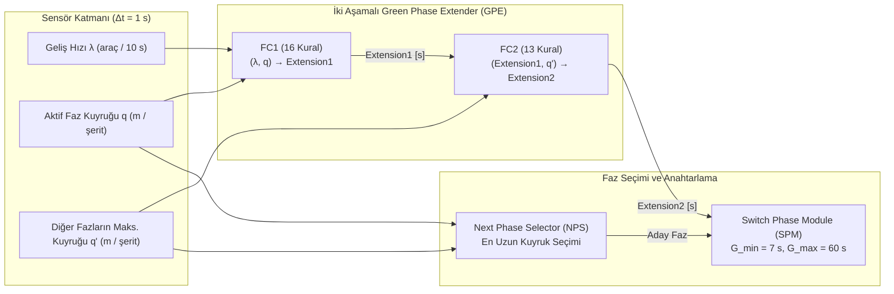

# İzole Kavşakta Trafik Sinyal Kontrolü için Benzerlik Optimizasyonlu Bulanık Çıkarım (OSFI-TSC)

## Öğrenci ve Ders Bilgileri

- **Ad Soyad:** Ömer Faruk İşcanlı
- **Öğrenci No:** `<doldurulacak>`
- **Ders:** Bulanık Mantık (Fuzzy Logic) — Dönem Projesi
- **Ders Sorumlusu:** `<doldurulacak>`

---

## Referans Makale

> Esmaeili, M., Anjomshoae, A., Shahsavari-Pour, N., Srisurin, P., & Banomyong, R. (2025). *"An optimization similarity fuzzy inference method for traffic signal control at an isolated intersection."* **Multimodal Transportation**, 4, 100234. [doi:10.1016/j.multra.2025.100234](https://doi.org/10.1016/j.multra.2025.100234)

---

## 1. Problem Tanımı

Kentsel ulaşım ağlarında sinyalize kavşaklar, farklı yönlerden gelen trafik akımlarının kesiştiği birincil darboğaz noktalarıdır. Sabit zamanlı (*fixed-time*) kontrolcüler anlık talep dalgalanmalarına uyum sağlayamazken, klasik bulanık mantık kontrolcüleri (Mamdani ve sıfırıncı dereceden Sugeno) sabit kural tabanları ve standart t-norm/durulaştırma operatörleri altında yüksek ve dengesiz trafik yüklerinde faz süresi tahsisinde sınırlarla karşılaşabilmektedir.

Bu projede, dört kollu (**E, S, W, N**) ve dört fazlı izole bir kavşakta:
1. Kuyruk uzunluğu (*queue length*, m/şerit) ve araç geliş hızı (*arrival rate*, araç/10 s) sensör verilerini kullanan iki aşamalı bulanık yeşil süre uzatma (**GPE: $\text{FC}_1 \to \text{FC}_2$**) mimarisi sıfırdan (*scikit-fuzzy* vb. hazır kütüphaneler kullanılmadan) gerçeklenmiş;
2. Referans makaledeki **Mamdani (CRI)**, **Sugeno (TSK)** ve **OSFI-literal** çıkarım motorları, klasik trafik mühendisliği referans yöntemleri olan **Webster sabit zamanlı** ve **Tam Trafik Uyarmalı (Vehicle-Actuated)** kontrolcülerle ortak rastgele sayılar (*Common Random Numbers*, 30 tohum) altında karşılaştırılmıştır.

---

## 2. Yöntem Özeti ve Bulanık Sistem Mimarisi

Bulanık trafik sinyal kontrolcüsü üç modülden oluşur:
- **Next Phase Selector (NPS):** Dört yaklaşım kolundaki kuyruk uzunluklarını karşılaştırarak en uzun kuyruğa sahip fazı seçer (eşitlik durumunda mevcut faz korunur, ardından $\text{E} \to \text{S} \to \text{W} \to \text{N}$ sırası izlenir).
- **Green Phase Extender (GPE):** İki kademeli bulanık çıkarım sistemi ($\text{FC}_1$ ve $\text{FC}_2$) ile aktif fazın yeşil süre uzatmasını (`Extension2`) hesaplar.
- **Switch Phase Module (SPM):** Minimum yeşil süre ($G_{\min} = 7\text{ s}$) ve her uzatma penceresi sonunda, diğer kollarda daha uzun kuyruk oluşup oluşmadığını veya uzatma süresinin eşik değerin ($\text{Extension2} < 1\text{ s}$) altına düşüp düşmediğini अथवा maksimum yeşil süreye ($G_{\max} = 60\text{ s}$) ulaşılıp ulaşılmadığını denetleyerek faz geçiş kararını uygular.

### 2.1. Sistem Blok Diyagramı



### 2.2. Üyelik Fonksiyonları (Membership Functions)

Makaledeki Şekil 4–7 esas alınarak tanımlanan dilsel değişkenler ve parametreleri aşağıdaki tabloda özetlenmiştir (metin-şekil farklılıkları için bkz. [`docs/assumptions.md`](docs/assumptions.md)):

| Değişken | Rol | Evren (Universe) | Küme Tipi | Dilsel Terimler ve Parametreler |
| :--- | :--- | :---: | :---: | :--- |
| **Arrival Rate ($\lambda$)** | $\text{FC}_1$ Giriş 1 | $[0, 12]$ araç/10 s | Gauss ($\sigma = 1.0$) | `Z`: $c=0$, `Lo`: $c=3$, `M`: $c=6$, `H`: $c=9$ |
| **Queue Length ($q$)** | $\text{FC}_1$ Giriş 2 | $[0, 60]$ m/şerit | Gauss ($\sigma = 5.0$) | `Sh`: $c=0$, `M`: $c=15$, `L`: $c=30$, `VL`: $c=45$ |
| **Extension1 ($e_1$)** | $\text{FC}_1$ Çıkış / $\text{FC}_2$ Giriş 1 | $[0, 25]$ s | Üçgen $(a,b,c)$ | `Z`: $(0,0,7.5)$, `Sh`: $(0,7.5,12.5)$, `M`: $(7.5,12.5,17.5)$, `L`: $(12.5,17.5,22.5)$ |
| **Competing Queue ($q'$)** | $\text{FC}_2$ Giriş 2 | $[0, 60]$ m/şerit | Gauss ($\sigma = 5.0$) | `Sh`: $c=0$, `M`: $c=15$, `L`: $c=30$, `VL`: $c=45$ |
| **Extension2 ($e_2$)** | $\text{FC}_2$ Çıkış | $[0, 25]$ s | Üçgen / Tekil Tepe | Üçgen (Mamdani) veya tepe değerleri $\{0, 7.5, 12.5, 17.5\}$ (Sugeno / OSFI-literal) |

- **Kural Tabanları:** 16 kurallı $\text{FC}_1$ ve 13 kurallı $\text{FC}_2$ tablolarının tamamı ve makalede doğrudan verilen 6 kural ile eşleşmesi [`docs/rule_bases.md`](docs/rule_bases.md) dosyasında yer almaktadır.
- **Üyelik Fonksiyonları Görseli:**


---

## 3. Veri ve Simülasyon Ortamı

- **Kuyruk Modeli:** Kesikli zamanlı ($\Delta t = 1\text{ s}$) dört kollu ($\text{E, S, W, N}$) M/M/1 tabanlı kavşak simülatörü (`src/osfi_tsc/sim/intersection.py`). Her kolda 2 şerit bulunur ve aynı anda yalnızca bir yaklaşım kolu yeşil ışık alır.
- **Servis ve Kayıp Süreler:** Etkin yeşil sürede şerit başına $\mu = 0.5\text{ araç/s/şerit}$ (toplam $1.0\text{ araç/s}$ doygunluk akımı, varsayılan `exponential` servis). Her yeşil faz başlangıcında $2\text{ s}$ başlangıç kayıp süresi (*start-up lost time*) ve faz geçişlerinde $3\text{ s}$ sarı $+ 2\text{ s}$ tümü-kırmızı ($5\text{ s}$ *intergreen*) uygulanır.
- **Yön Dağılımı ve Senaryolar:** Yön oranları referans makalenin Tablo 1 Mamdani çıkış sayılarından ($328, 398, 165, 173$, toplam $1064$) tam kesir olarak hesaplanmıştır ($\text{E}=0.3083, \text{S}=0.3741, \text{W}=0.1551, \text{N}=0.1626$):
  - `moderate`: Sabit toplam $1800\text{ araç/saat}$ ($Y = 0.5000 < 0.95$)
  - `heavy`: Sabit toplam $2500\text{ araç/saat}$ ($Y = 0.6944 < 0.95$)
  - `peak`: Yamuk (*trapezoid*) profil $1500 \to 2700 \to 1500\text{ araç/saat}$ ($15\text{ dk}$ artış, $30\text{ dk}$ zirve, $15\text{ dk}$ düşüş; saatlik ortalama $2400\text{ araç/saat}$, $Y = 0.6667 < 0.95$)
- **Simülasyon Ufku:** $600\text{ s}$ ısınma (*warm-up*) $+ 3600\text{ s}$ ölçüm penceresi. Her `(senaryo, tohum)` çifti için geliş zaman damgaları önceden üretilerek tüm kontrolcülerin birebir aynı araç geliş akımını görmesi (*Common Random Numbers*) garanti altına alınmıştır.

---

## 4. Kurulum ve Çalıştırma

### 4.1. Kurulum

```bash
git clone https://github.com/oiscanli/osfi-traffic-signal-control.git
cd osfi-traffic-signal-control
python3 -m venv .venv
source .venv/bin/activate
pip install --upgrade pip
pip install -r requirements.txt
pip install -e .
```

### 4.2. Testlerin, Deneylerin ve Şekillerin Çalıştırılması

Temiz bir klondan tüm birim testlerini, 30 tohumlu yeniden üretim deneylerini ve akademik figür üretimini tek komutta çalıştırmak için:

```bash
pip install -e . && pytest -q && python scripts/run_reproduction.py && python scripts/make_figures.py
```

---

## 5. Yeniden Üretim Deneyleri ve Sonuçlar

### 5.1. Kontrol Yüzeyleri ($\text{FC}_1$ ve $\text{FC}_2$)


### 5.2. Makale Tablo 1 / Tablo 2 Formatında Karşılaştırma (`n = 30` Tohum Ortalaması)

> **Not:** Yüzde iyileşme sütunlarında fiziksel olarak doğru işaret kuralı kullanılmıştır: **Average Delay** için pozitif değer daha düşük gecikmeyi, **Average Exit** için pozitif değer daha yüksek araç çıkışını ifade eder. Makalenin kendi tablolarındaki işaret ve payda tutarsızlıkları [`docs/paper_inconsistencies.md`](docs/paper_inconsistencies.md) ve [`results/summary/paper_vs_ours.md`](results/summary/paper_vs_ours.md) dosyalarında ayrıntılı olarak belgelenmiştir.

#### Orta Yoğunluklu Trafik (`moderate`, 1800 araç/saat)

| Gösterge | Faz | Mamdani | Sugeno | OSFI-literal | % İyileşme vs Mamdani | % İyileşme vs Sugeno | Makale Yönü Yeniden Üretildi mi? |
| :--- | :---: | ---: | ---: | ---: | ---: | ---: | :--- |
| Average Delay (s) | E | 216.06 | 335.94 | 339.00 | -56.90% | -0.91% | No |
| Average Delay (s) | S | 181.57 | 289.47 | 291.93 | -60.78% | -0.85% | No |
| Average Delay (s) | W | 419.99 | 658.65 | 667.63 | -58.96% | -1.36% | No |
| Average Delay (s) | N | 400.48 | 628.13 | 636.51 | -58.94% | -1.33% | No |
| Average Exit (veh) | E | 513.2 | 482.6 | 480.9 | -6.29% | -0.35% | No |
| Average Exit (veh) | S | 627.3 | 594.2 | 594.0 | -5.31% | -0.04% | No |
| Average Exit (veh) | W | 235.5 | 204.2 | 205.3 | -12.84% | +0.51% | Partial (vs Sugeno only) |
| Average Exit (veh) | N | 250.1 | 219.0 | 220.2 | -11.93% | +0.58% | Partial (vs Sugeno only) |

#### Yoğun Trafik (`heavy`, 2500 araç/saat)

| Gösterge | Faz | Mamdani | Sugeno | OSFI-literal | % İyileşme vs Mamdani | % İyileşme vs Sugeno | Makale Yönü Yeniden Üretildi mi? |
| :--- | :---: | ---: | ---: | ---: | ---: | ---: | :--- |
| Average Delay (s) | E | 687.76 | 830.03 | 831.30 | -20.87% | -0.15% | No |
| Average Delay (s) | S | 565.73 | 709.36 | 704.57 | -24.54% | +0.68% | Partial (vs Sugeno only) |
| Average Delay (s) | W | 1491.89 | 1881.75 | 1887.90 | -26.54% | -0.33% | No |
| Average Delay (s) | N | 1390.82 | 1734.05 | 1739.71 | -25.09% | -0.33% | No |
| Average Exit (veh) | E | 568.0 | 527.2 | 527.2 | -7.19% | -0.01% | No |
| Average Exit (veh) | S | 727.3 | 682.7 | 683.0 | -6.09% | +0.05% | Partial (vs Sugeno only) |
| Average Exit (veh) | W | 181.7 | 137.6 | 137.9 | -24.12% | +0.19% | Partial (vs Sugeno only) |
| Average Exit (veh) | N | 196.4 | 154.8 | 154.3 | -21.43% | -0.30% | No |

### 5.3. Tüm Kontrolcülerin Genel Gecikme Dağılımı


**Bulguların Analizi:**
1. **Mamdani vs. Sugeno / OSFI-literal Farkının Nedeni:** $\text{FC}_2$ çıkış kümesi olan `Zero` ($\text{Z} = (0, 0, 7.5)$), $[0, 7.5]$ aralığında sağ-dik üçgendir. Mamdani ağırlık merkezi (*centroid*) durulaştırmasında `Z` kümesinin ağırlık merkezi $\approx 2.50\text{ s}$ ($\ge 1.0\text{ s}$) olduğundan, diğer fazlarda kuyruk uzun (`VL`) olsa bile Mamdani yeşil süreyi $3\text{ s}$ uzatmaya devam ederek sık faz değişimi kayıplarını azaltır. Buna karşılık Sugeno ve OSFI-literal'de `Z` tepe değeri $0.0\text{ s}$ olduğundan $\text{Extension2} < 1\text{ s}$ koşulu tetiklenir ve her $G_{\min} = 7\text{ s}$ sonunda faz değiştirilir.
2. **OSFI-literal vs. Sugeno:** OSFI-literal ile sıfırıncı dereceden Sugeno arasındaki tek fark ($\min$ yerine Łukasiewicz t-normu $\max(0, f_1+f_2-1)$) eşleştirilmiş Wilcoxon işaretli sıra testlerinde (`results/summary/wilcoxon_tests.md`) istatistiksel olarak anlamlı bir fark yaratmamaktadır ($p_{\text{Holm}} > 0.09$). Ayrıca Łukasiewicz t-normunda $\sum \alpha_i = 0$ durumu `moderate` senaryoda $\text{FC}_1$ çağrılarının $\%0.06$'sında, `peak` senaryoda ise $\%0.65$'inde Sugeno geri-düşüşünü (*fallback*) tetiklemiştir.

---

## 6. Özgün Katkı (Stage 2)

> **Not (Stub):** Projenin **Özgün Katkı** bölümü (Deng & Jiang 2014 doğruluk tablosu benzerlik optimizasyonunun gerçeklenmesi, SPM faz geçiş kararsızlığının giderilmesi ve gürültülü sensör analizi) **Stage 2** kapsamında eklenecektir.

---

## 7. Kısıtlar (Limitations)

- Stage 1 simülasyonu izole dört kollu tek bir kavşağı kapsamakta olup koridor koordinasyonu (yeşil dalga) veya yaya fazlarını içermemektedir.
- Makaledeki SPM kuralı (`q_others_max > q_cur` olduğunda $G_{\min}$ sonunda anında faz değiştirme), $5\text{ s}$ intergreen $+ 2\text{ s}$ başlangıç kaybı nedeniyle sık faz değişimine (*phase thrashing*) yol açmaktadır; bu yapısal darboğaz Stage 2'de iyileştirilecektir.

---

## 8. Depo Yapısı (Repository Structure)

```text
osfi-tsc/
  README.md  requirements.txt  LICENSE  .gitignore  pyproject.toml
  configs/
    default.yaml
    scenarios/{moderate,heavy,peak}.yaml
  src/osfi_tsc/
    fuzzy/{membership.py, operators.py, rules.py}
    inference/{mamdani.py, sugeno.py, osfi_literal.py}
    control/{fuzzy_controller.py, webster.py, actuated.py}
    sim/{demand.py, intersection.py}
    metrics.py  experiment.py  plotting.py
  scripts/
    run_reproduction.py  make_figures.py
  tests/
    test_fuzzy_primitives.py  test_inference.py  test_sim_and_controllers.py
  results/
    raw/  summary/
  figures/
  docs/
    assumptions.md  paper_inconsistencies.md  rule_bases.md
```

---

## 9. Kaynaklar

1. Esmaeili, M., Anjomshoae, A., Shahsavari-Pour, N., Srisurin, P., & Banomyong, R. (2025). An optimization similarity fuzzy inference method for traffic signal control at an isolated intersection. *Multimodal Transportation*, 4, 100234.
2. Deng, G., & Jiang, Y. (2014). Fuzzy reasoning method by optimizing the similarity of truth-tables. *Information Sciences*, 288, 290–313.
3. Webster, F. V. (1958). *Traffic Signal Settings*. Road Research Technical Paper No. 39, HMSO, London.
4. Pappis, C. P., & Mamdani, E. H. (1977). A fuzzy logic controller for a traffic junction. *IEEE Transactions on Systems, Man, and Cybernetics*, 7(10), 707–717.
