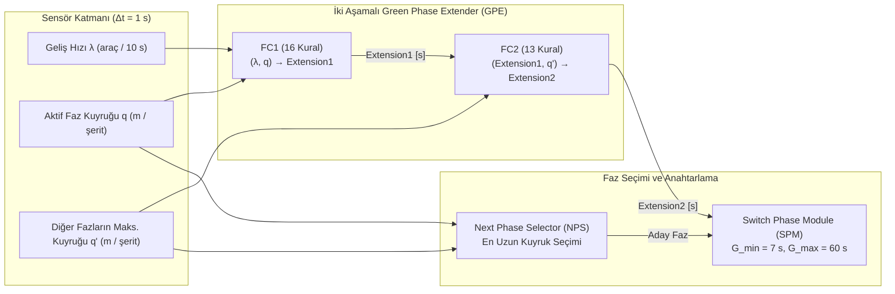
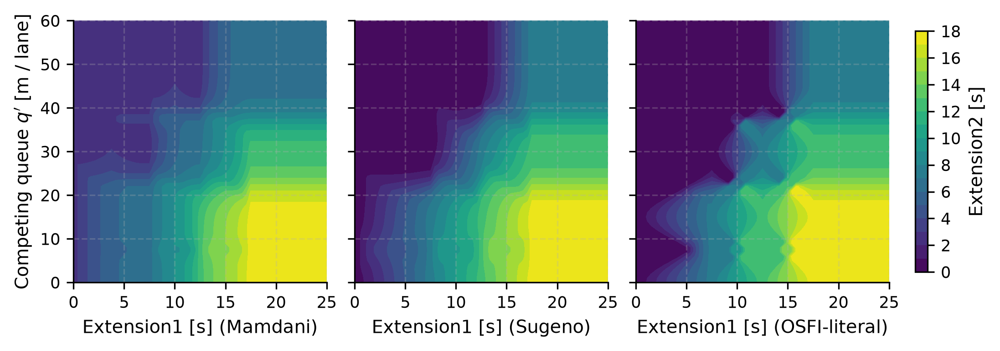
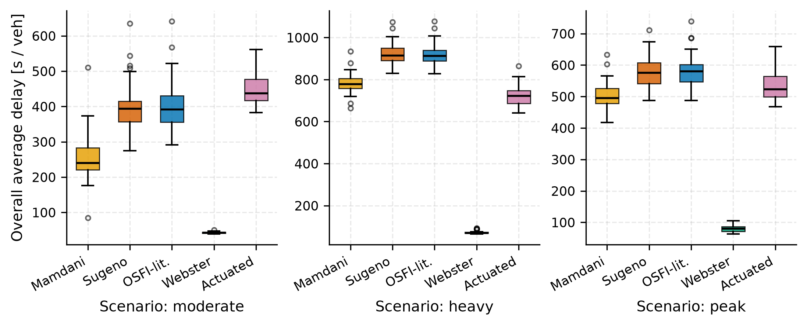
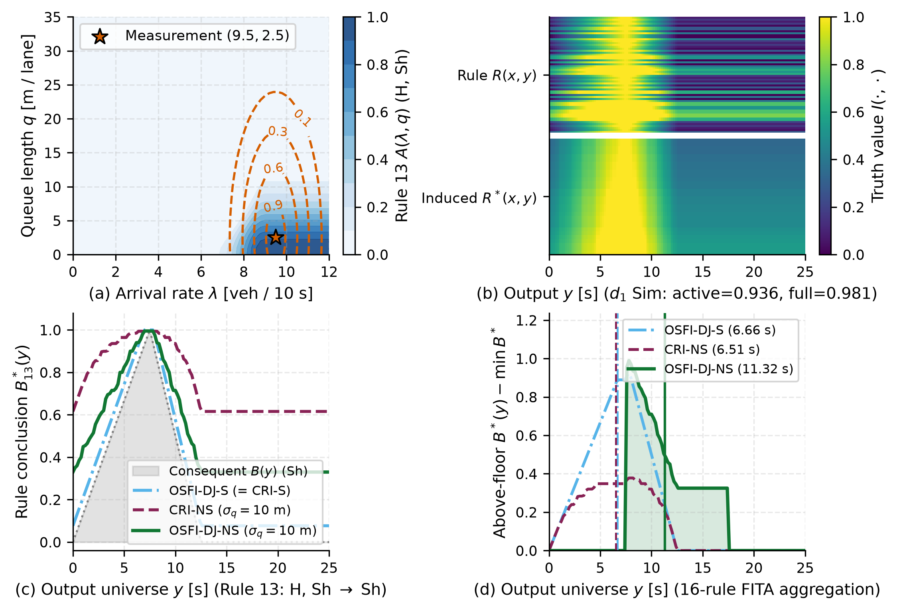
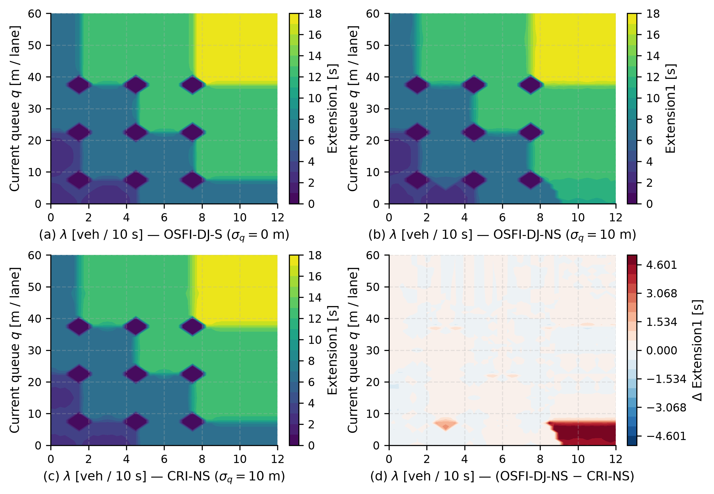
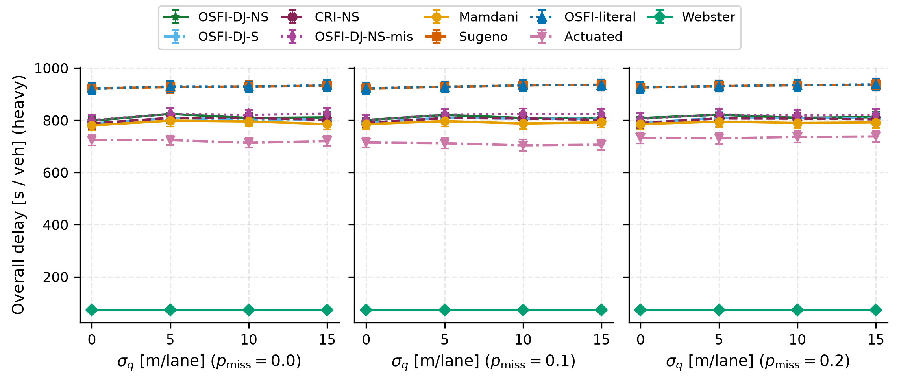
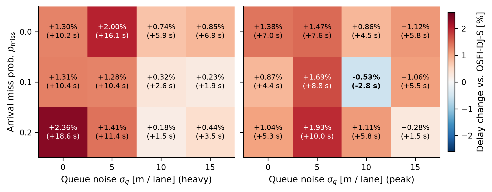
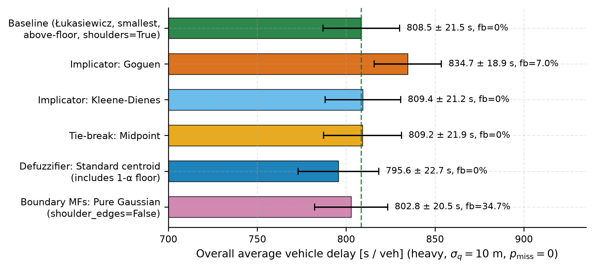

# İzole Kavşakta Trafik Sinyal Kontrolü için Benzerlik Optimizasyonlu Bulanık Çıkarım (OSFI-TSC)

## Öğrenci ve Ders Bilgileri

- **Ad Soyad:** Ömer Faruk İşcanlı
- **Öğrenci No:** `<doldurulacak>`
- **Ders:** Bulanık Mantık (Fuzzy Logic) — Dönem Projesi
- **Ders Sorumlusu:** `<doldurulacak>`

---

## Referans Makale

> Esmaeili, M., Anjomshoae, A., Shahsavari-Pour, N., Srisurin, P., & Banomyong, R. (2025). *"An optimization similarity fuzzy inference method for traffic signal control at an isolated intersection."* **Multimodal Transportation**, 4, 100234. [doi:10.1016/j.multra.2025.100234](https://doi.org/10.1016/j.multra.2025.100234)

---

## 1. Problem Tanımı

Kentsel ulaşım ağlarında sinyalize kavşaklar, farklı yönlerden gelen trafik akımlarının kesiştiği birincil darboğaz noktalarıdır. Sabit zamanlı (*fixed-time*) kontrolcüler anlık talep dalgalanmalarına uyum sağlayamazken, klasik bulanık mantık kontrolcüleri (Mamdani ve sıfırıncı dereceden Sugeno) sabit kural tabanları ve standart t-norm/durulaştırma operatörleri altında yüksek ve dengesiz trafik yüklerinde faz süresi tahsisinde sınırlarla karşılaşabilmektedir.

Bu projede, dört kollu (**E, S, W, N**) ve dört fazlı izole bir kavşakta:
1. Kuyruk uzunluğu (*queue length*, m/şerit) ve araç geliş hızı (*arrival rate*, araç/10 s) sensör verilerini kullanan iki aşamalı bulanık yeşil süre uzatma (**GPE: $\text{FC}_1 \to \text{FC}_2$**) mimarisi sıfırdan (*scikit-fuzzy* vb. hazır kütüphaneler kullanılmadan) gerçeklenmiş;
2. Referans makaledeki **Mamdani (CRI)**, **Sugeno (TSK)** ve **OSFI-literal** çıkarım motorları, klasik trafik mühendisliği referans yöntemleri olan **Webster sabit zamanlı** ve **Tam Trafik Uyarmalı (Vehicle-Actuated)** kontrolcülerle ortak rastgele sayılar (*Common Random Numbers*, 30 tohum) altında karşılaştırılmıştır.

---

## 2. Yöntem Özeti ve Bulanık Sistem Mimarisi

Bulanık trafik sinyal kontrolcüsü üç modülden oluşur:
- **Next Phase Selector (NPS):** Dört yaklaşım kolundaki kuyruk uzunluklarını karşılaştırarak en uzun kuyruğa sahip fazı seçer (eşitlik durumunda mevcut faz korunur, ardından $\text{E} \to \text{S} \to \text{W} \to \text{N}$ sırası izlenir).
- **Green Phase Extender (GPE):** İki kademeli bulanık çıkarım sistemi ($\text{FC}_1$ ve $\text{FC}_2$) ile aktif fazın yeşil süre uzatmasını (`Extension2`) hesaplar.
- **Switch Phase Module (SPM):** Minimum yeşil süre ($G_{\min} = 7\text{ s}$) ve her uzatma penceresi sonunda, diğer kollarda daha uzun kuyruk oluşup oluşmadığını veya uzatma süresinin eşik değerin ($\text{Extension2} < 1\text{ s}$) altına düşüp düşmediğini अथवा maksimum yeşil süreye ($G_{\max} = 60\text{ s}$) ulaşılıp ulaşılmadığını denetleyerek faz geçiş kararını uygular.

### 2.1. Sistem Blok Diyagramı



### 2.2. Üyelik Fonksiyonları (Membership Functions)

Makaledeki Şekil 4–7 esas alınarak tanımlanan dilsel değişkenler ve parametreleri aşağıdaki tabloda özetlenmiştir (metin-şekil farklılıkları için bkz. [`docs/assumptions.md`](docs/assumptions.md)):

| Değişken | Rol | Evren (Universe) | Küme Tipi | Dilsel Terimler ve Parametreler |
| :--- | :--- | :---: | :---: | :--- |
| **Arrival Rate ($\lambda$)** | $\text{FC}_1$ Giriş 1 | $[0, 12]$ araç/10 s | Gauss ($\sigma = 1.0$) | `Z`: $c=0$, `Lo`: $c=3$, `M`: $c=6$, `H`: $c=9$ |
| **Queue Length ($q$)** | $\text{FC}_1$ Giriş 2 | $[0, 60]$ m/şerit | Gauss ($\sigma = 5.0$) | `Sh`: $c=0$, `M`: $c=15$, `L`: $c=30$, `VL`: $c=45$ |
| **Extension1 ($e_1$)** | $\text{FC}_1$ Çıkış / $\text{FC}_2$ Giriş 1 | $[0, 25]$ s | Üçgen $(a,b,c)$ | `Z`: $(0,0,7.5)$, `Sh`: $(0,7.5,12.5)$, `M`: $(7.5,12.5,17.5)$, `L`: $(12.5,17.5,22.5)$ |
| **Competing Queue ($q'$)** | $\text{FC}_2$ Giriş 2 | $[0, 60]$ m/şerit | Gauss ($\sigma = 5.0$) | `Sh`: $c=0$, `M`: $c=15$, `L`: $c=30$, `VL`: $c=45$ |
| **Extension2 ($e_2$)** | $\text{FC}_2$ Çıkış | $[0, 25]$ s | Üçgen / Tekil Tepe | Üçgen (Mamdani) veya tepe değerleri $\{0, 7.5, 12.5, 17.5\}$ (Sugeno / OSFI-literal) |

- **Kural Tabanları:** 16 kurallı $\text{FC}_1$ ve 13 kurallı $\text{FC}_2$ tablolarının tamamı ve makalede doğrudan verilen 6 kural ile eşleşmesi [`docs/rule_bases.md`](docs/rule_bases.md) dosyasında yer almaktadır.
- **Üyelik Fonksiyonları Görseli:**


---

## 3. Veri ve Simülasyon Ortamı

- **Kuyruk Modeli:** Kesikli zamanlı ($\Delta t = 1\text{ s}$) dört kollu ($\text{E, S, W, N}$) M/M/1 tabanlı kavşak simülatörü (`src/osfi_tsc/sim/intersection.py`). Her kolda 2 şerit bulunur ve aynı anda yalnızca bir yaklaşım kolu yeşil ışık alır.
- **Servis ve Kayıp Süreler:** Etkin yeşil sürede şerit başına $\mu = 0.5\text{ araç/s/şerit}$ (toplam $1.0\text{ araç/s}$ doygunluk akımı, varsayılan `exponential` servis). Her yeşil faz başlangıcında $2\text{ s}$ başlangıç kayıp süresi (*start-up lost time*) ve faz geçişlerinde $3\text{ s}$ sarı $+ 2\text{ s}$ tümü-kırmızı ($5\text{ s}$ *intergreen*) uygulanır.
- **Yön Dağılımı ve Senaryolar:** Yön oranları referans makalenin Tablo 1 Mamdani çıkış sayılarından ($328, 398, 165, 173$, toplam $1064$) tam kesir olarak hesaplanmıştır ($\text{E}=0.3083, \text{S}=0.3741, \text{W}=0.1551, \text{N}=0.1626$):
  - `moderate`: Sabit toplam $1800\text{ araç/saat}$ ($Y = 0.5000 < 0.95$)
  - `heavy`: Sabit toplam $2500\text{ araç/saat}$ ($Y = 0.6944 < 0.95$)
  - `peak`: Yamuk (*trapezoid*) profil $1500 \to 2700 \to 1500\text{ araç/saat}$ ($15\text{ dk}$ artış, $30\text{ dk}$ zirve, $15\text{ dk}$ düşüş; saatlik ortalama $2400\text{ araç/saat}$, $Y = 0.6667 < 0.95$)
- **Simülasyon Ufku:** $600\text{ s}$ ısınma (*warm-up*) $+ 3600\text{ s}$ ölçüm penceresi. Her `(senaryo, tohum)` çifti için geliş zaman damgaları önceden üretilerek tüm kontrolcülerin birebir aynı araç geliş akımını görmesi (*Common Random Numbers*) garanti altına alınmıştır.

---

## 4. Kurulum ve Çalıştırma

### 4.1. Kurulum

```bash
git clone https://github.com/oiscanli/osfi-traffic-signal-control.git
cd osfi-traffic-signal-control
python3 -m venv .venv
source .venv/bin/activate
pip install --upgrade pip
pip install -r requirements.txt
pip install -e .
```

### 4.2. Testlerin, Deneylerin ve Şekillerin Çalıştırılması

Temiz bir klondan tüm birim testlerini, 30 tohumlu yeniden üretim (Stage 1) ve özgün katkı (Stage 2) deneylerini ve tüm akademik figür üretimini çalıştırmak için:

```bash
pip install -e .
pytest -q
python scripts/run_reproduction.py
python scripts/run_contribution.py
python scripts/make_figures.py
```

---

## 5. Yeniden Üretim Deneyleri ve Sonuçlar (Stage 1)

### 5.1. Kontrol Yüzeyleri ($\text{FC}_1$ ve $\text{FC}_2$)




### 5.2. Makale Tablo 1 / Tablo 2 Formatında Karşılaştırma (`n = 30` Tohum Ortalaması)

> **Not:** Yüzde iyileşme sütunlarında fiziksel olarak doğru işaret kuralı kullanılmıştır: **Average Delay** için pozitif değer daha düşük gecikmeyi, **Average Exit** için pozitif değer daha yüksek araç çıkışını ifade eder. Makalenin kendi tablolarındaki işaret ve payda tutarsızlıkları [`docs/paper_inconsistencies.md`](docs/paper_inconsistencies.md) ve [`results/summary/paper_vs_ours.md`](results/summary/paper_vs_ours.md) dosyalarında ayrıntılı olarak belgelenmiştir.

#### Orta Yoğunluklu Trafik (`moderate`, 1800 araç/saat)

| Gösterge | Faz | Mamdani | Sugeno | OSFI-literal | % İyileşme vs Mamdani | % İyileşme vs Sugeno | Makale Yönü Yeniden Üretildi mi? |
| :--- | :---: | ---: | ---: | ---: | ---: | ---: | :--- |
| Average Delay (s) | E | 216.06 | 335.94 | 339.00 | -56.90% | -0.91% | No |
| Average Delay (s) | S | 181.57 | 289.47 | 291.93 | -60.78% | -0.85% | No |
| Average Delay (s) | W | 419.99 | 658.65 | 667.63 | -58.96% | -1.36% | No |
| Average Delay (s) | N | 400.48 | 628.13 | 636.51 | -58.94% | -1.33% | No |
| Average Exit (veh) | E | 513.2 | 482.6 | 480.9 | -6.29% | -0.35% | No |
| Average Exit (veh) | S | 627.3 | 594.2 | 594.0 | -5.31% | -0.04% | No |
| Average Exit (veh) | W | 235.5 | 204.2 | 205.3 | -12.84% | +0.51% | Partial (vs Sugeno only) |
| Average Exit (veh) | N | 250.1 | 219.0 | 220.2 | -11.93% | +0.58% | Partial (vs Sugeno only) |

#### Yoğun Trafik (`heavy`, 2500 araç/saat)

| Gösterge | Faz | Mamdani | Sugeno | OSFI-literal | % İyileşme vs Mamdani | % İyileşme vs Sugeno | Makale Yönü Yeniden Üretildi mi? |
| :--- | :---: | ---: | ---: | ---: | ---: | ---: | :--- |
| Average Delay (s) | E | 687.76 | 830.03 | 831.30 | -20.87% | -0.15% | No |
| Average Delay (s) | S | 565.73 | 709.36 | 704.57 | -24.54% | +0.68% | Partial (vs Sugeno only) |
| Average Delay (s) | W | 1491.89 | 1881.75 | 1887.90 | -26.54% | -0.33% | No |
| Average Delay (s) | N | 1390.82 | 1734.05 | 1739.71 | -25.09% | -0.33% | No |
| Average Exit (veh) | E | 568.0 | 527.2 | 527.2 | -7.19% | -0.01% | No |
| Average Exit (veh) | S | 727.3 | 682.7 | 683.0 | -6.09% | +0.05% | Partial (vs Sugeno only) |
| Average Exit (veh) | W | 181.7 | 137.6 | 137.9 | -24.12% | +0.19% | Partial (vs Sugeno only) |
| Average Exit (veh) | N | 196.4 | 154.8 | 154.3 | -21.43% | -0.30% | No |

### 5.3. Tüm Kontrolcülerin Genel Gecikme Dağılımı



**Stage 1 Bulgularının Analizi:**
1. **Mamdani vs. Sugeno / OSFI-literal Farkının Nedeni:** $\text{FC}_2$ çıkış kümesi olan `Zero` ($\text{Z} = (0, 0, 7.5)$), $[0, 7.5]$ aralığında sağ-dik üçgendir. Mamdani ağırlık merkezi (*centroid*) durulaştırmasında `Z` kümesinin ağırlık merkezi $\approx 2.50\text{ s}$ ($\ge 1.0\text{ s}$) olduğundan, diğer fazlarda kuyruk uzun (`VL`) olsa bile Mamdani yeşil süreyi $3\text{ s}$ uzatmaya devam ederek sık faz değişimi kayıplarını azaltır. Buna karşılık Sugeno ve OSFI-literal'de `Z` tepe değeri $0.0\text{ s}$ olduğundan $\text{Extension2} < 1\text{ s}$ koşulu tetiklenir ve her $G_{\min} = 7\text{ s}$ sonunda faz değiştirilir.
2. **OSFI-literal vs. Sugeno:** OSFI-literal ile sıfırıncı dereceden Sugeno arasındaki tek fark ($\min$ yerine Łukasiewicz t-normu $\max(0, f_1+f_2-1)$) eşleştirilmiş Wilcoxon işaretli sıra testlerinde (`results/summary/wilcoxon_tests.md`) istatistiksel olarak anlamlı bir fark yaratmamaktadır ($p_{\text{Holm}} > 0.09$). Ayrıca Łukasiewicz t-normunda $\sum \alpha_i = 0$ durumu `moderate` senaryoda $\text{FC}_1$ çağrılarının $\%0.06$'sında, `peak` senaryoda ise $\%0.65$'inde Sugeno geri-düşüşünü (*fallback*) tetiklemiştir.

---

## 6. Özgün Katkı: Sadık Deng & Jiang (2014) OSFI Motoru ve Gürültülü Sensör Dayanıklılığı (Stage 2)

### 6.1. Motivasyon ve Kuramsal Katkı (Proposition 1)

Esmaeili vd. (2025), Bölüm 3.2 Eşitlik (1)'de Deng & Jiang (2014) tarafından önerilen **doğruluk tablosu benzerlik optimizasyonu** (*Truth-Table Optimization Similarity Fuzzy Inference*, **OSFI-DJ**) kuramını tanıtmış; ancak Bölüm 4.1.2'de bu optimizasyonu çözmek yerine sıfırıncı dereceden ağırlıklı ortalama formülüne (`OSFI-literal`) geçmiştir. Ayrıca makalenin Bölüm 6.1'inde, **hatalı veya gürültülü trafik sensörleri** çalışmanın temel kısıtlarından biri olarak belirtilmiştir.

Stage 2 kapsamında ilk olarak Deng & Jiang (2014) benzerlik optimizasyonu:

$$B^*_i(y) = \underset{b \in [0, 1]}{\arg\min} \sum_{x \in X} \bigl| I(A_i(x), B_i(y)) - I(A^*(x), b) \bigr|$$

her kural $i$ ve çıkış ızgarası noktası $y \in [0, 25]\text{ s}$ için tam olarak çözülmüş ve aşağıdaki **Önerme 1 (Proposition 1 — Singleton Equivalence)** kanıtlanmıştır (tam türetim ve kanıt için bkz. [`docs/osfi_theory.md`](docs/osfi_theory.md)):

> **Önerme 1 (Tekil Giriş Eşdeğerliği):** Giriş bulanık kümesi $A^*$ bir $x_0 \in X$ noktasında tekil (*singleton*) küme ise ($A^*(x_0)=1$, $\forall x \neq x_0$ için $A^*(x)=0$):
> 1. $I(0, b) = 1$ ve $I(1, b) = b$ sınır koşullarını sağlayan tüm gerçek implikatörler (**Łukasiewicz**, **Goguen**, **Kleene-Dienes**) için $x \neq x_0$ terimleri $b$'den bağımsız sabittir ve amaç fonksiyonu $\bigl|I(A_i(x_0), B_i(y)) - b\bigr|$ terimine indirgenir. Dolayısıyla tekil çözüm:
>    $$B^*_{\text{OSFI}}(y) = I\bigl(A_i(x_0), B_i(y)\bigr) = \sup_{x \in X} T\bigl(A^*(x), I(A_i(x), B_i(y))\bigr) = B^*_{\text{CRI}}(y)$$
>    olup **OSFI-DJ ile Compositional Rule of Inference (CRI) birebir çakışır** (birim testlerde ızgara noktalarında maksimum mutlak hata $< 10^{-15}$).
> 2. Mamdani minimum operatörü $I_M(a,b) = \min(a,b)$ için ($I_M(0,b)=0$), amaç fonksiyonu $b \in [\min(A_i(x_0), B_i(y)), 1]$ aralığında düz bir plato oluşturur ve en özgül (*smallest*) minimizer seçimi altında $B^*_{\text{OSFI}}(y) = \min(A_i(x_0), B_i(y))$ olarak Mamdani kırpma (*clipping*) sonucunu verir.
> 3. **Sonuç:** Benzerlik optimizasyonu ($\arg\max \text{Sim}(R, R^*)$), klasik CRI'dan **yalnızca giriş kümesi tekil olmadığında (*non-singleton*, $\sigma > 0$)** ayrışır: CRI en iyimser tek bir hücre üzerinden $\sup_x$ alırken, OSFI-DJ aktif destek kümesindeki $\{x : A^*(x) > 10^{-3}\}$ tüm hücreler üzerinden ağırlıklı $L_1$ medyan problemi çözer.



### 6.2. Yöntem ve Deneysel Tasarım

1. **Çıkarım Motorları (`src/osfi_tsc/inference/osfi_dj.py` ve `cri.py`):**
   - `OSFI-DJ-S`: Tekil (*singleton*, $\sigma_1=\sigma_2=0$) girişli sadık Deng & Jiang (2014) çıkarım motoru.
   - `OSFI-DJ-NS`: Sensör gürültüsü ile eşleştirilmiş (*matched*) Gauss girişli ($\sigma_\lambda, \sigma_q$) tekil-olmayan OSFI-DJ motoru.
   - `OSFI-DJ-NS-mis`: Yanlış kalibre edilmiş (*mismatched*, sabit $\sigma_\lambda = 1.0$, $\sigma_q = 5.0\text{ m}$) tekil-olmayan OSFI-DJ motoru.
   - `CRI-NS`: Eşleştirilmiş Gauss girişli $\sup\text{-}T$ CRI kontrol referansı (benzerlik optimizasyonunun etkisini izole etmek için).
   - Çoklu kural birleştirme **FITA** (*First-Infer-Then-Aggregate*, gerçek implikatörler için $\min_i B^*_i(y)$) ve taban üstü ağırlık merkezi (**`centroid_above_floor`**: $B^*(y) - \min_y B^*(y)$ ağırlık merkezi) ile gerçekleştirilmiştir.
   - Çoklu işlemci (*multiprocessing*) ile 44 adet 2B arama tablosu (`results/cache/*.npz`) önbelleğe alınmış ve çalışma zamanında çift doğrusal (*bilinear*) interpolasyon kullanılmıştır (500 rastgele ızgara-dışı noktada medyan interpolasyon hatası $\le 0.013\text{ s}$; bkz. [`results/summary/contribution_lut_stats.md`](results/summary/contribution_lut_stats.md)).



2. **Sensör Gürültü Modeli (`src/osfi_tsc/sim/intersection.py`):**
   - **Kuyruk sensörü:** $\hat{q}_t = \max(0, q_t + \mathcal{N}(0, \sigma_q^2))$, $\sigma_q \in \{0, 5, 10, 15\}\text{ m/şerit}$.
   - **Geliş sayacı:** Her gerçek araç $1 - p_{\text{miss}}$ olasılıkla algılanır ($p_{\text{miss}} \in \{0.0, 0.1, 0.2\}$) ve $p_{\text{miss}} > 0$ olduğunda $\text{Poisson}(\varepsilon \cdot 10\text{ s})$ ($\varepsilon = 0.02\text{ araç/s}$) yanlış sayım (*false count*) eklenir.
   - Tüm gürültü akımları her `(senaryo, tohum)` için ayrı tohumlarla önceden üretilerek 9 kontrolcünün tamamında birebir aynı gürültülü ölçümlerin görülmesi sağlanmıştır.

### 6.3. Deney A — Gürültüsüz Ortamda Sadık `OSFI-DJ-S` Karşılaştırması (`n = 30` Tohum)

Tam tablo için bkz. [`results/summary/contribution_exp_a_summary.md`](results/summary/contribution_exp_a_summary.md):

| Senaryo | `Mamdani` (s/araç) | `Sugeno` (s/araç) | `OSFI-literal` (s/araç) | `OSFI-DJ-S` (s/araç) | `Actuated` (s/araç) | `Webster` (s/araç) | `OSFI-DJ-S` vs `OSFI-literal` Değişim |
| :--- | ---: | ---: | ---: | ---: | ---: | ---: | ---: |
| `moderate` | $258.62 \pm 29.07$ | $400.52 \pm 29.17$ | $405.13 \pm 29.71$ | **$271.36 \pm 29.62$** | $445.58 \pm 16.86$ | $43.06 \pm 0.91$ | **$-33.02\%$ ($-133.8\text{ s}$)** |
| `heavy` | $780.64 \pm 19.60$ | $922.69 \pm 22.06$ | $921.43 \pm 22.24$ | **$787.95 \pm 20.58$** | $724.15 \pm 19.73$ | $72.70 \pm 3.02$ | **$-14.49\%$ ($-133.5\text{ s}$)** |
| `peak` | $505.60 \pm 17.74$ | $582.11 \pm 20.23$ | $585.74 \pm 20.26$ | **$510.63 \pm 15.31$** | $535.06 \pm 17.48$ | $79.69 \pm 3.96$ | **$-12.82\%$ ($-75.1\text{ s}$)** |

**Yorum:** Makalenin sıfırıncı dereceden `OSFI-literal` formülü yerine gerçek Deng & Jiang (2014) doğruluk tablosu çıkarımı (`OSFI-DJ-S`) kullanıldığında, `Z` çıkış üçgeninin taban üstü ağırlık merkezi korunmakta ve ortalama araç gecikmesi her üç senaryoda da `Sugeno` ve `OSFI-literal`'e kıyasla **$\%12.8$ ile $\%33.0$ arasında ($75\text{--}134\text{ s/araç}$) azalmaktadır**.

### 6.4. Deney B — Sensör Gürültüsü Izgarası ($\sigma_q \times p_{\text{miss}}$, `6,480` Koşu)

Tam tablolar ve Holm-Bonferroni düzeltmeli Wilcoxon testleri için bkz. [`results/summary/contribution_exp_b_summary.md`](results/summary/contribution_exp_b_summary.md) ve [`results/summary/contribution_wilcoxon.md`](results/summary/contribution_wilcoxon.md):





**Temel Bulgular:**
1. **`Sugeno` ve `OSFI-literal`'e Karşı Üstünlük:** `heavy` ve `peak` senaryolarındaki $12$ gürültü hücresinin tamamında `OSFI-DJ-NS`, `Sugeno` ve `OSFI-literal`'e kıyasla istatistiksel olarak anlamlı biçimde daha düşük gecikme sağlamaktadır ($p_{\text{Holm}} = 7.45 \times 10^{-9}$, medyan eşleştirilmiş gecikme azalması `heavy` senaryoda $-103\text{ s}$ ile $-127\text{ s}$ [$-11.3\%$ ile $-14.2\%$], `peak` senaryoda $-59\text{ s}$ ile $-80\text{ s}$ [$-9.8\%$ ile $-13.1\%$]).
2. **Düşük vs. Yüksek Kuyruk Gürültüsünde `OSFI-DJ-NS` ve `OSFI-DJ-S` / `CRI-NS`:**
   - Düşük kuyruk gürültüsünde ($\sigma_q \in \{0, 5\}\text{ m}$), Gauss giriş bulanıklaştırması komşu kuralları da kısmen ateşleyerek yeşil uzatmaları hafifçe artırmakta ve `OSFI-DJ-S`'ye kıyasla $\%1\text{--}2$ daha yüksek gecikmeye yol açmaktadır.
   - Yüksek kuyruk gürültüsünde ($\sigma_q \in \{10, 15\}\text{ m}$), `heavy` senaryoda `OSFI-DJ-NS`, `OSFI-DJ-S` ve `CRI-NS` arasındaki fark istatistiksel olarak sıfıra yakınsamaktadır (medyan eşleştirilmiş fark $0.00\text{ s/araç}$, $p_{\text{Holm}} > 0.20$). `peak` senaryoda ise $(\sigma_q=10\text{ m}, p_{\text{miss}}=0.1)$ hücresinde `OSFI-DJ-NS` ortalama gecikmeyi `OSFI-DJ-S`'ye göre $-2.79\text{ s}$ ($-0.53\%$), $(\sigma_q=10\text{ m}, p_{\text{miss}}=0.2)$ hücresinde ise medyan bazda $-0.13\text{ s}$ azaltmaktadır.
3. **Yapısal Neden Analizi:** Yüksek $\sigma_q$ altında tüm bulanık kontrolcülerin benzer gecikme sergilemesinin nedeni, referans makalenin **SPM faz geçiş kuralının** (`if q_others_max > q_cur: switch immediately after G_min`) bulanık çıkarım motorunu devre dışı bırakarak doğrudan ham gürültülü kuyruk ölçümlerini karşılaştırmasıdır.

### 6.5. Deney C — Ablasyon Çalışması (`heavy`, $\sigma_q = 10\text{ m}$, $p_{\text{miss}} = 0$, `n = 30` Tohum)

Tam tablo için bkz. [`results/summary/contribution_exp_c_summary.md`](results/summary/contribution_exp_c_summary.md):



| Faktör | Varyant | Ortalama Gecikme (s/araç) $\pm$ 95% CI | Çıkış (araç/saat) | Faz Geçişi | Sıfır-Alan Fallback Oranı |
| :--- | :--- | ---: | ---: | ---: | ---: |
| **Baseline** | `lukasiewicz` + `smallest` + `centroid_above_floor` + `shoulder=True` | $808.53 \pm 21.53$ | $1653.5 \pm 16.9$ | $277.5$ | $0.00\%$ |
| **Implicator** | `goguen` | $834.66 \pm 18.95$ | $1615.9 \pm 15.6$ | $282.8$ | $6.98\%$ ($\text{FC}_2: 13.95\%$) |
| **Implicator** | `kleene_dienes` | $809.44 \pm 21.23$ | $1651.7 \pm 13.5$ | $277.8$ | $0.00\%$ |
| **Tie-Break** | `midpoint` | $809.21 \pm 21.92$ | $1651.8 \pm 16.7$ | $277.7$ | $0.00\%$ |
| **Defuzzifier** | `centroid` (taban dahil standart ağırlık merkezi) | **$795.63 \pm 22.68$** | $1653.2 \pm 16.0$ | $277.7$ | $0.00\%$ |
| **Boundary MFs** | `shoulder_edges = False` (saf Gauss) | $802.85 \pm 20.49$ | $1647.9 \pm 13.8$ | $278.0$ | **$34.70\%$ ($\text{FC}_1: 69.40\%$)** |

**Ablasyon Bulguları:**
- **`shoulder_edges = False` Etkisi:** Sınır omuzları kaldırıldığında, $q > 45\text{ m}$ kuyruk uzunluklarında `VL` üyelik derecesi sıfıra doğru düştüğü için $\text{FC}_1$ çağrılarının **$\%69.40$'ında** (toplam çağrıların $\%34.70$'inde) sıfır-alan geri-düşüşü (*zero-area fallback*) meydana gelmektedir. Bu bulgu, omuzlu sınır kümelerinin (`shoulder_edges = True`) zorunlu olduğunu kanıtlamaktadır.
- **İmplikatör Seçimi:** `goguen` implikatörü ($I_G(a,b) = \min(1, b/a)$) $\text{FC}_2$'de $\%13.95$ oranında düz plato üreterek gecikmeyi $834.66\text{ s}$'ye kötüleştirirken, `lukasiewicz` ve `kleene_dienes` $\%0$ fallback ile kararlı çalışmaktadır.
- **Durulaştırıcı Seçimi (`centroid` vs `centroid_above_floor`):** $(1-\alpha)$ tabanını koruyan standart `centroid` durulaştırıcısı, uzatma sürelerini evren ortasına ($12.5\text{ s}$) doğru çekerek erken faz kesilmelerini azaltmakta ve gecikmeyi $808.53\text{ s}$'den $795.63\text{ s}$'ye düşürmektedir.

---

## 7. Kısıtlar (Limitations)

- Simülasyon ortamı dört kollu izole bir kavşağı kapsamakta olup koridor koordinasyonu (yeşil dalga) veya yaya/dönüş fazlarını içermemektedir.
- Referans makalenin SPM mimarisindeki ham kuyruk karşılaştırması (`q_others_max > q_cur`), yüksek kuyruk sensörü gürültüsü ($\sigma_q \ge 10\text{ m}$) altında GPE bulanık uzatma kararlarını erken sonlandırarak tüm bulanık kontrolcülerde faz çırpınmasına (*phase thrashing*) neden olmaktadır. Gelecek çalışmalarda SPM anahtarlama koşulunun da üstel hareketli ortalama (EMA) veya bulanık histerezis eşiği ile filtrelenmesi önerilmektedir.

---

## 8. Depo Yapısı (Repository Structure)

```text
osfi-tsc/
  README.md  requirements.txt  LICENSE  .gitignore  pyproject.toml
  configs/
    default.yaml
    scenarios/{moderate,heavy,peak}.yaml
  src/osfi_tsc/
    fuzzy/{membership.py, operators.py, rules.py}
    inference/{mamdani.py, sugeno.py, osfi_literal.py, cri.py, osfi_dj.py}
    control/{fuzzy_controller.py, webster.py, actuated.py}
    sim/{demand.py, intersection.py}
    metrics.py  experiment.py  contribution.py  plotting.py
  scripts/
    run_reproduction.py  run_contribution.py  make_figures.py
  tests/
    test_fuzzy_primitives.py  test_inference.py  test_osfi_dj.py  test_sim_and_controllers.py
  results/
    raw/  summary/  cache/
  figures/
  docs/
    assumptions.md  experiment_log.md  osfi_theory.md  paper_inconsistencies.md  rule_bases.md
```

---

## 9. Kaynaklar

1. Esmaeili, M., Anjomshoae, A., Shahsavari-Pour, N., Srisurin, P., & Banomyong, R. (2025). An optimization similarity fuzzy inference method for traffic signal control at an isolated intersection. *Multimodal Transportation*, 4, 100234.
2. Deng, G., & Jiang, Y. (2014). Fuzzy reasoning method by optimizing the similarity of truth-tables. *Information Sciences*, 288, 290–313.
3. Webster, F. V. (1958). *Traffic Signal Settings*. Road Research Technical Paper No. 39, HMSO, London.
4. Pappis, C. P., & Mamdani, E. H. (1977). A fuzzy logic controller for a traffic junction. *IEEE Transactions on Systems, Man, and Cybernetics*, 7(10), 707–717.

